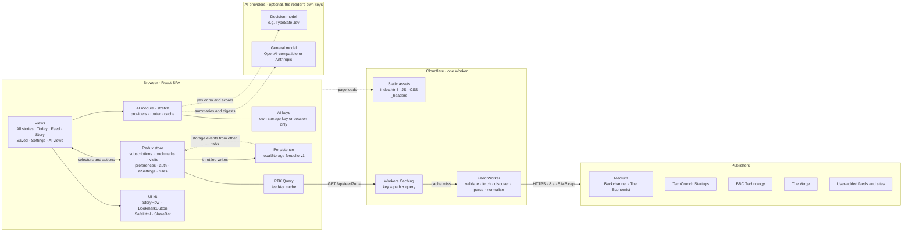
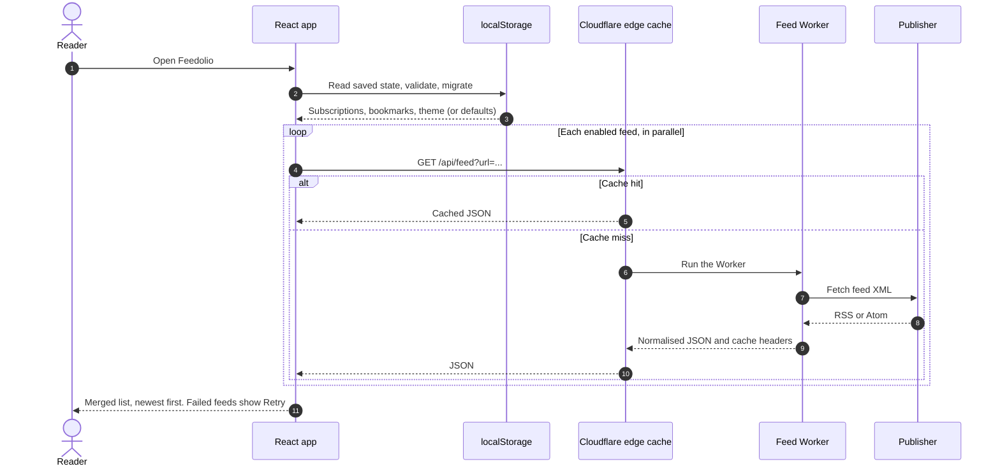
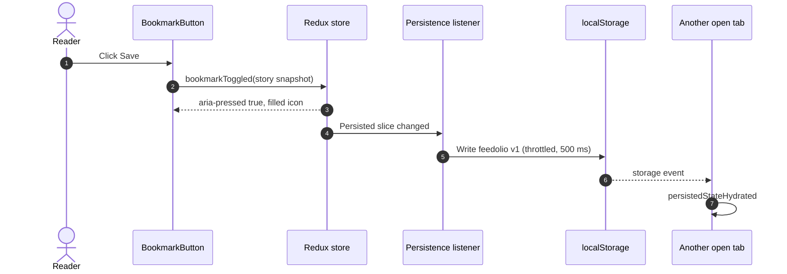
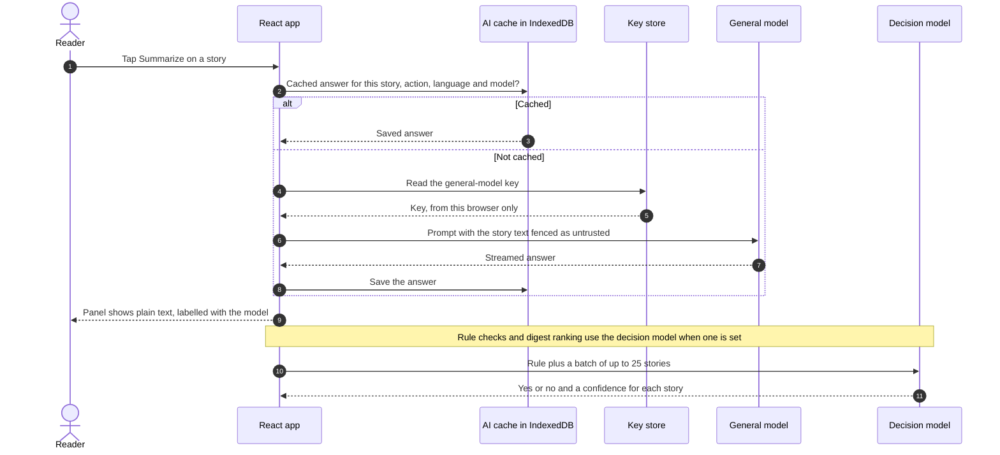
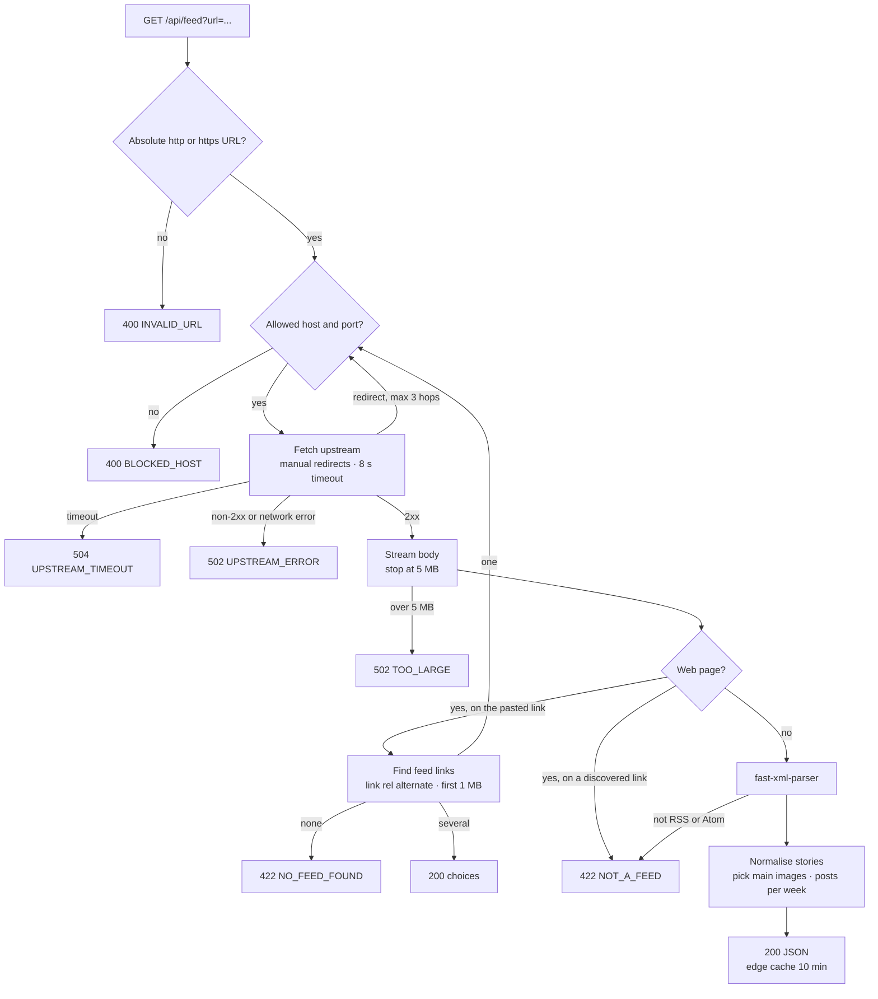

# Feedolio RSS Reader — System Design & Implementation Plan

> **Method:** Anthropic's official [`engineering`](https://github.com/anthropics/knowledge-work-plugins/tree/main/engineering) plugin:
> - [`system-design`](https://github.com/anthropics/knowledge-work-plugins/blob/main/engineering/skills/system-design/SKILL.md) for the framework (requirements, design, deep dive, scale, trade-offs),
> - [`architecture`](https://github.com/anthropics/knowledge-work-plugins/blob/main/engineering/skills/architecture/SKILL.md) for the decision records (ADRs),
> - [`testing-strategy`](https://github.com/anthropics/knowledge-work-plugins/blob/main/engineering/skills/testing-strategy/SKILL.md) for the test plan.
>
> **Sources:** the "Simple RSS Reader" brief (`docs/` PDF), a live inspection of the sample feeds on 2026-11-06, and research into Feedly, Inoreader, NetNewsWire, Reeder, Feedbin and Readwise Reader on 2026-11-09.
> **Status:** Proposed; ADR-001, ADR-007, ADR-008 and ADR-009 accepted; test approach confirmed · **Date:** 2026-11-06, updated 2026-11-09 · **Deciders:** the developer.

---

## 0. Summary

- **What:** a React (JavaScript) single-page app for reading RSS and Atom feeds, with bookmarks that persist and optional AI help on the reader's own keys.
- **How:** one **Cloudflare Worker** serves the built app and a small feed endpoint, `GET /api/feed`. The endpoint exists because no sample feed allows cross-site browser requests.
- **Inside the endpoint:** fetch the feed, convert XML to JSON with `fast-xml-parser`, and normalise it into one `Story` shape, including a "main image" pick.
- **In the app:** Redux Toolkit holds state (RTK Query for feeds; slices for subscriptions, bookmarks and preferences). User data persists to `localStorage`. Styling is CSS Modules plus design tokens, with no CSS libraries.
- **Reader comforts** (from research into popular readers): a Today view, date headers, a "New since your last visit" divider, List or Cards layouts, keyboard shortcuts, reading settings, and adding a feed from any website link (the Worker discovers the feed).
- **Optional AI (stretch):** article actions, plain-English filter rules and a "Catch me up" digest, on the reader's own keys, called straight from the browser. There's no AI backend and no AI cost to us.

| # | Decision | Choice | Record |
|---|---|---|---|
| 1 | How the browser gets feed data | Own endpoint that fetches and normalises feeds | [ADR-001](#adr-001-fetch-feeds-through-our-own-serverless-endpoint) |
| 2 | State management | Redux Toolkit plus RTK Query | [ADR-002](#adr-002-redux-toolkit-with-rtk-query-for-state) |
| 3 | Bookmark persistence | Versioned `localStorage` layer storing story snapshots | [ADR-003](#adr-003-persist-bookmarks-as-story-snapshots-in-localstorage) |
| 4 | Styling without CSS libraries | CSS Modules plus design tokens | [ADR-004](#adr-004-css-modules-plus-design-tokens-no-css-libraries) |
| 5 | Showing untrusted feed HTML | DOMPurify at render time | [ADR-005](#adr-005-sanitise-feed-html-on-the-client-with-dompurify) |
| 6 | OAuth | Auth0 SPA SDK with GitHub login | [ADR-006](#adr-006-oauth-via-auth0-with-github) |
| 7 | Hosting | Cloudflare Workers with static assets | [ADR-007](#adr-007-host-on-cloudflare-workers-with-static-assets) |
| 8 | AI (stretch) | Bring your own keys, called from the browser; optional decision model | [ADR-008](#adr-008-ai-with-bring-your-own-keys-called-from-the-browser) |
| 9 | What's new | A since-last-visit divider, not unread tracking | [ADR-009](#adr-009-a-since-last-visit-divider-not-unread-tracking) |

**Effort:** about 52 hours for the app (M0–M9), plus about 23 for the optional AI features (M10–M13) ([§7](#7-implementation-plan)).

---

## 1. Requirements

### 1.1 Functional requirements

| ID | Requirement | Source | Priority |
|---|---|---|---|
| FR-01 | Show story headlines in a list | Brief: required | Must |
| FR-02 | Clicking a headline shows **all** content the feed provides, on a **separate page** | Brief: required | Must |
| FR-03 | Bookmark a story, with UI showing the saved state | Brief: required | Must |
| FR-04 | Bookmarks persist across sessions | Brief: required | Must |
| FR-05 | Convert RSS XML to JSON with a library | Brief: suggested | Must |
| FR-06 | No CSS libraries (Bootstrap, Material UI, Tailwind, etc.) | Brief: required | Must |
| FR-07 | View multiple feeds | Brief: required | Must |
| FR-08 | Responsive on mobile and tablet | Brief: required | Must |
| FR-09 | Show each story's main image in the list | Brief: bonus | Should |
| FR-10 | Social sharing (Facebook, X, email) | Brief: bonus | Should |
| FR-11 | Add your own feeds by link; manage and remove them (Settings) | Brief: bonus | Must (raised 2026-11-09) |
| FR-12 | Use Redux | Brief: bonus | Should (adopted) |
| FR-13 | Automated tests | Brief: bonus | Must (treated as required) |
| FR-14 | OAuth sign-in (GitHub) | Brief: bonus | Should (raised 2026-11-09) |
| FR-15 | Combined "All stories" view, newest first | Added | Should |
| FR-16 | Saved stories stay readable after leaving the feed | Added | Should |
| FR-17 | Clear layout for summary-only feeds | Added (TechCrunch has no full body) | Should |
| FR-18 | Light, dark and system theme | Added | Should (raised 2026-11-09) |
| FR-19 | Bookmarks sync between open tabs | Added | Could |
| FR-20 | Today view (last 24 hours) and date headers | Added (reader research) | Should |
| FR-21 | "New since your last visit" divider, instead of read/unread tracking | Added (reader research) | Should |
| FR-22 | List or Cards layout, with Comfortable or Compact density | Added (reader research) | Should |
| FR-23 | Keyboard shortcuts with a `?` overlay | Added (reader research) | Should |
| FR-24 | Reading settings on the story page (text size, font, line width) | Added (reader research) | Should |
| FR-25 | Add a feed from any website or feed link: discovery, `choices`, preview with posts per week | Added (reader research) | Must (part of FR-11) |
| FR-26 | First-visit welcome note and suggested feeds | Added (reader research) | Should |
| FR-27 | AI setup: bring your own keys (general model, optional decision model), kept in the browser | Added (AI) | Stretch |
| FR-28 | AI article actions: Summarize, Translate, Explain | Added (AI) | Stretch |
| FR-29 | AI filter rules (hide, highlight, tag) with Maybe and Hidden views; nothing ever deleted | Added (AI) | Stretch |
| FR-30 | AI "Catch me up" digest, ranked, linking to sources | Added (AI) | Stretch |
| FR-31 | Collapsible desktop sidebar (slim icon rail, `[` to toggle) | Added (reader research) | Should |

### 1.2 Non-functional requirements

| Area | Target |
|---|---|
| **Performance** | Initial JS ≤ 150 KB gzipped. LCP ≤ 2.5 s on a mid-range phone over Fast 4G. Feed endpoint ≤ 100 ms on an edge-cache hit. |
| **Availability** | Static app on Cloudflare's network. One failing feed never blanks the others. If a publisher errors, the last good copy (up to 24 h old) is served. |
| **Security** | No script execution from feed or model content. The endpoint can't be used to reach private addresses. None of our secrets in the client; readers' AI keys stay in their browser and go only to their own provider. |
| **Privacy** | No third-party trackers or social SDKs. Feed images load with `no-referrer`. |
| **Accessibility** | WCAG 2.2 AA: full keyboard use, visible focus, 44 px touch targets, 4.5:1 contrast. |
| **Responsive** | 320 px to 1920 px wide, breakpoints at 640 px and 1024 px, usable at 200% zoom. |
| **Browsers** | Last two versions of Chrome, Edge, Firefox and Safari; iOS Safari 16+. |
| **Cost** | $0: Cloudflare Workers Free and the Auth0 free tier. AI usage is billed to the reader's own keys. |
| **AI key safety** | Keys are never logged, never in error messages, and never sent to `/api/feed`. Model output never runs as code. |
| **AI cost to readers** | The reader pays their provider, so Feedolio keeps usage low: batching, caching, caps and a usage counter. |
| **Maintainability** | Lint-clean; tests in CI on every push; README records decisions and trade-offs. |

### 1.3 Constraints

- **Language:** React with JavaScript, no TypeScript. JSDoc types describe the shapes.
- **No CSS libraries.** Small non-CSS libraries are fine (router, Redux, parser, sanitiser).
- **Team and time:** one developer, about 4–5 focused days.
- **Codebase:** greenfield; the repository only contains `docs/`.
- **Feeds are third-party:** they block cross-site requests, vary in format, and some have moved or are archived (§1.5).
- **Workers Free plan:** 100,000 Worker requests a day and **10 ms of CPU time per request**. Time spent waiting on the network doesn't count.
- **AI without a backend:** AI calls go straight from the browser, so each provider must accept cross-site (CORS) requests.

### 1.4 Assumptions

- "Persist across sessions" means across browser restarts on the same device. Cross-device sync is not required (settled: [§10](#10-settled-decisions)).
- A small server-side endpoint next to the React app is acceptable (settled: [§10](#10-settled-decisions)).
- Reviewers will try the app on a desktop browser and a phone.
- Adding live feeds beyond the brief's three samples is welcome ("use any other source also").
- **AI providers accept browser requests**, checked 2026-11-09. CORS preflights succeeded for:
  - Anthropic (`access-control-allow-origin: *`, including the `anthropic-dangerous-direct-browser-access` header),
  - OpenAI (echoes the origin),
  - OpenRouter (`*`).
  Ollama needs `OLLAMA_ORIGINS`.
- **TypeSafe Jev's request format is unconfirmed.** No public API reference was found on 2026-11-09. OpenRouter lists `~typesafe/jev-latest` with a "decisions" output but no serving endpoints yet. The general model covers judging until the format is confirmed (before M12).

### 1.5 Findings from the sample feeds (2026-11-06)

| Feed | Format | Body | Images | Items | CORS | Notes |
|---|---|---|---|---|---|---|
| Backchannel (`medium.com/feed/backchannel`) | RSS 2.0 | Full HTML in `content:encoded` (one item has `description` only) | First `<figure>` is the hero; **last `` is a tracking pixel** (`medium.com/_/stat…`) | 10 | None | Archived: newest item Jan 2018 |
| The Economist (`medium.com/feed/the-economist`) | RSS 2.0 | Full HTML, includes `<iframe>` embeds | As Backchannel | 10 | None | Archived: newest item Apr 2020 |
| TechCrunch: brief's URL (`techcrunch.com/startups/feed/`) | — | — | — | — | — | **Moved:** served the feed until mid-2022, redirected to `/category/startups/feed/` from Oct 2022, and now returns 404 with an HTML "Page not found" page (Wayback Machine) |
| TechCrunch Startups (`techcrunch.com/category/startups/feed/`) | RSS 2.0 | **Summary only** (70–370 characters) | **None** | 20 | Only `techcrunch.com` | guid isn't a permalink; several authors per item |
| BBC Technology (`feeds.bbci.co.uk/news/technology/rss.xml`) | RSS 2.0 + Media RSS | Summary only | `media:thumbnail` on every item | 21 | — | Live |
| The Verge (`theverge.com/rss/index.xml`) | **Atom** | Full HTML | First `` in the content | 10 | — | Live |

**What this means for the design:**

- Feeds must be fetched server-side (ADR-001).
- Main-image logic needs three strategies plus a fallback.
- The story page needs a full-content layout and a summary-only layout.
- Default feeds should include live sources.

---

## 2. High-Level Design

### 2.1 Component diagram



AI calls go from the browser straight to the reader's providers. They never pass through the Worker.

### 2.2 Data flows

**A. Opening the app (All stories)**



- `selectMergedStories` merges the loaded feeds, removes duplicates by `story.id` and sorts newest first.
- Each feed has its own loading and error state.

**B. Opening a story** (`/feeds/:feedId/stories/:storyId`)

The story is resolved in this order:

1. The RTK Query cache for that feed.
2. Fetch the feed for that subscription, then look the story up. This is the deep-link or refresh case.
3. The bookmark snapshot.
4. Otherwise `StoryUnavailable`, with a link to the original if known.

The story renders through `SafeHtml`. Summary-only stories (`hasFullContent: false`) get a "Continue reading on {host}" button.

**C. Toggling a bookmark**



Un-saving shows a toast with **Undo**, which dispatches `bookmarkRestored`.

**D. Adding a feed from any link**

1. **Check locally:** the link is absolute http(s) (a bare `theverge.com` gets `https://` added) and not already followed once normalised.
2. **Preview:** a lazy `getFeed` query calls `GET /api/feed?url=…`.
   - A feed link returns the feed.
   - A web page is searched for `<link rel="alternate">` feed links (§3.3). With one link, the Worker fetches that feed. With several, it returns `choices` and the dialog asks the reader to pick. With none, it returns `NO_FEED_FOUND`.
   - The preview shows the title, the latest three headlines and `postsPerWeek`, or the endpoint's error message.
3. **Confirm:** `subscriptionAdded({ url, title })`, using the feed's own URL rather than the page's. The feed appears in the sidebar and in All stories.

**E. An AI request (stretch)**



- Keys go only to the provider they belong to, and never to `/api/feed`.
- Rule checks run after new stories load, in batches of up to 25, once per story and rule version.
- Without a decision model, the same calls go to the general model, which uses a wider Maybe band (ADR-008).

### 2.3 API contract: `GET /api/feed`

| | |
|---|---|
| **Query** | `url` (required): absolute `http:` or `https:` feed **or website** URL, URL-encoded |
| **200 body** | `application/json` with a `FeedResponse` (§3.1), or `{ choices }` when a web page links to several feeds |
| **200 headers** | `Cloudflare-CDN-Cache-Control: max-age=600, stale-while-revalidate=3600, stale-if-error=86400` (edge) and `Cache-Control: no-cache` (browsers) |
| **Error body** | `{ "error": { "code": string, "message": string, "upstreamStatus"?: number } }` |
| **Error headers** | `Cache-Control: no-store` |

| Code | HTTP | Cause |
|---|---|---|
| `INVALID_URL` | 400 | Missing or malformed URL, or a scheme other than http(s) |
| `BLOCKED_HOST` | 400 | `localhost`, a literal private, loopback, link-local or reserved IP (IPv4 or IPv6), or a port other than 80/443 |
| `UPSTREAM_TIMEOUT` | 504 | No complete response within 8 s |
| `UPSTREAM_ERROR` | 502 | Non-2xx upstream status (in `upstreamStatus`), or a network failure |
| `NOT_A_FEED` | 422 | Neither a feed nor a web page (e.g. an image or JSON), or a discovered link that returns another web page |
| `NO_FEED_FOUND` | 422 | A web page with no RSS or Atom `<link rel="alternate">` |
| `TOO_LARGE` | 502 | Body larger than 5 MB |

> [!WARNING]
> Don't use `s-maxage` here. On Cloudflare, `s-maxage` turns off `stale-while-revalidate` and `stale-if-error`. The edge directives go in `Cloudflare-CDN-Cache-Control` instead.

Example success response (shortened):

```json
{
  "feed": {
    "id": "f_k3x9q2",
    "url": "https://techcrunch.com/category/startups/feed/",
    "title": "Startups | TechCrunch",
    "description": "…",
    "siteUrl": "https://techcrunch.com/",
    "imageUrl": "https://…/favicon.png",
    "postsPerWeek": 34
  },
  "stories": [
    {
      "id": "s_8f2c1a",
      "feedId": "f_k3x9q2",
      "title": "Harbinger raises $240M after expanding into defense",
      "link": "https://techcrunch.com/2026/11/05/…",
      "author": "Sean O'Kane",
      "publishedAt": "2026-11-05T17:52:44.000Z",
      "categories": ["Fundraising", "Startups", "Transportation"],
      "excerpt": "…",
      "contentHtml": "<p>…</p>",
      "hasFullContent": false,
      "imageUrl": null,
      "imageSource": null
    }
  ],
  "fetchedAt": "2026-11-06T21:04:11.000Z"
}
```

Example `choices` response, for a page that links to two feeds:

```json
{
  "choices": [
    { "title": "BBC News - Technology", "url": "https://feeds.bbci.co.uk/news/technology/rss.xml" },
    { "title": "BBC News - Science & Environment", "url": "https://feeds.bbci.co.uk/news/science_and_environment/rss.xml" }
  ]
}
```

### 2.4 Storage choices

| Data | Where | Lifetime | Why |
|---|---|---|---|
| Normalised feed responses | Cloudflare edge (Workers Caching, shared) and RTK Query (in memory, per tab) | Edge: 10 min fresh, then stale-while-revalidate. Memory: 10 min after last use. | Public, re-fetchable data. Shared caching protects publishers. |
| Subscriptions, bookmarks (with snapshots), preferences | `localStorage["feedolio:v1"]`, or `feedolio:v1:<userId>` when signed in | Until the user clears it | Small, synchronous, universally supported (ADR-003) |
| Auth session | Auth0 SDK: in memory, with refresh-token rotation | Session | SDK defaults; no tokens in `localStorage` |
| Theme before first paint | Inline script in `index.html` reads `feedolio:v1` | — | Avoids a flash of the wrong theme |
| Visit record, AI settings and rules | Inside `feedolio:v1` (no secrets) | Until the user clears it | Small; drives the divider, the digest window and the AI views |
| AI keys (stretch) | `localStorage["feedolio:ai-keys:v1"]`, or `sessionStorage` when "Remember on this device" is off; per user when signed in | Until removed, or until the tab closes | Kept apart so keys never travel with other data |
| Judgments and AI output (stretch) | IndexedDB `feedolio-ai` | Until cleared; trimmed after 30 days | Can grow large; async access is fine for this data |

---

## 3. Deep Dive

### 3.1 Data model

```js
/**
 * @typedef {Object} Subscription
 * @property {string}  id         Stable short hash of the normalised URL, e.g. "f_k3x9q2"
 * @property {string}  url        Normalised feed URL
 * @property {string}  title      From the feed
 * @property {boolean} enabled    Included in "All stories"
 * @property {boolean} isDefault  Seeded on first run
 * @property {string}  addedAt    ISO timestamp
 */

/**
 * @typedef {Object} Story
 * @property {string}   id              Hash of guid → link → title+publishedAt, e.g. "s_8f2c1a"
 * @property {string}   feedId
 * @property {string}   title
 * @property {string}   link            Publisher URL; used by share buttons
 * @property {string|null} author
 * @property {string|null} publishedAt  ISO; null sorts last
 * @property {string[]} categories
 * @property {string}   excerpt         Plain text, ≤ 200 chars
 * @property {string}   contentHtml     Raw HTML; sanitised only at render time
 * @property {boolean}  hasFullContent  false for summary-only feeds
 * @property {string|null} imageUrl     Main image; null → MonogramTile
 * @property {'media'|'enclosure'|'content'|null} imageSource  Lets StoryPage skip a duplicate hero
 */

/**
 * @typedef {Object} FeedResponse
 * @property {{id:string,url:string,title:string,description:string,siteUrl:string|null,imageUrl:string|null,postsPerWeek:number|null}} feed
 * @property {Story[]} stories
 * @property {string}  fetchedAt
 */

/**
 * @typedef {Object} FeedChoices   Returned when a web page links to several feeds
 * @property {{title:string,url:string}[]} choices
 */

/**
 * @typedef {Object} Bookmark
 * @property {string} id         Same as story.id
 * @property {string} feedId
 * @property {string} feedTitle  Kept so the bookmark renders even if the feed is removed
 * @property {string} savedAt    ISO timestamp
 * @property {Story}  story      Full snapshot at save time
 */

/**
 * @typedef {Object} Preferences
 * @property {'system'|'light'|'dark'} theme
 * @property {'list'|'cards'} layout
 * @property {'comfortable'|'compact'} density
 * @property {{size:'s'|'m'|'l'|'xl', font:'serif'|'sans', width:'narrow'|'wide'}} reading
 * @property {'auto'|'expanded'|'collapsed'} sidebar   'auto' = expanded from 1280 px, rail at 1024–1279 px
 */

/**
 * @typedef {Object} Visits
 * @property {string|null} lastVisitAt    ISO; the value read at start-up is this session's divider cut-off
 * @property {string|null} lastCatchUpAt  ISO; start of the next "Catch me up" window
 * @property {string[]}    openedIds      Most recent 2,000 opened story ids
 */

/**
 * @typedef {Object} AiSettings   Stretch. No secrets: keys are stored separately.
 * @property {{provider:'anthropic'|'openai'|'openrouter'|'ollama'|'custom', baseUrl:string, model:string}} general
 * @property {{provider:'jev', model:string}|null} decision
 * @property {{actions:boolean, rules:boolean, catchUp:boolean}} features
 * @property {string}  translateTo    e.g. "en"
 * @property {boolean} rememberKeys   false → keys live in sessionStorage only
 */

/**
 * @typedef {Object} Rule   Stretch
 * @property {string}  id
 * @property {string}  text      Plain English, e.g. "Hide event announcements and conference promotions"
 * @property {'hide'|'highlight'|'tag'} action
 * @property {string|null} tag
 * @property {boolean} enabled
 * @property {number}  version   Bumped on every edit; judgments for older versions are ignored
 */

/**
 * @typedef {Object} Judgment   Stretch; stored in IndexedDB "feedolio-ai"
 * @property {string} storyId
 * @property {string} ruleId
 * @property {number} ruleVersion
 * @property {'match'|'maybe'|'no'} verdict
 * @property {number} confidence   0 to 1
 * @property {'decision'|'general'} by
 * @property {'yes'|'no'|undefined} readerSaid   The reader's answer in Maybe wins over the model
 */

/** Persisted envelope in localStorage["feedolio:v1"] */
// { version: 1, subscriptions, bookmarks, preferences, visits, aiSettings, rules }
// AI keys: localStorage["feedolio:ai-keys:v1"] (or sessionStorage) · judgments and AI output: IndexedDB "feedolio-ai"
```

### 3.2 Redux store

| Slice | State | Actions | Key selectors |
|---|---|---|---|
| `subscriptions` | Entity adapter, sorted by `addedAt` | `subscriptionAdded`, `subscriptionRemoved`, `subscriptionToggled`, `defaultsRestored` | `selectEnabledSubscriptions`, `selectSubscriptionById`, `selectIsSubscribed(url)` |
| `bookmarks` | Entity adapter, sorted by `savedAt` desc | `bookmarkToggled(story)`, `bookmarkRemoved(id)`, `bookmarkRestored(bookmark)` | `selectIsBookmarked(id)`, `selectAllBookmarks`, `selectBookmarkCount` |
| `preferences` | `{ theme, layout, density, reading, sidebar }` | `themeChanged`, `layoutChanged`, `densityChanged`, `readingChanged`, `sidebarToggled` | `selectTheme`, `selectLayout`, `selectReading`, `selectSidebar` |
| `visits` | `{ lastVisitAt, lastCatchUpAt, openedIds }`, plus this session's `cutoff` (not persisted) | `visitStarted`, `visitEnded`, `storyOpened`, `caughtUp` | `selectDividerCutoff`, `selectIsNew(story)`, `selectDigestCandidates` |
| `auth` | `{ status, user }` | `signedIn`, `signedOut` | `selectUserId` |
| `aiSettings` (stretch) | `AiSettings`, no keys | `generalSaved`, `decisionSaved`, `featureToggled`, `aiReset` | `selectAiEnabled`, `selectModelFor(task)` |
| `rules` (stretch) | Entity adapter of `Rule` | `ruleAdded`, `ruleEdited` (bumps `version`), `ruleToggled`, `ruleRemoved` | `selectEnabledRules` |
| `feedApi` | RTK Query | `getFeed(url)` | `selectMergedStories(urls)` (memoised) |

**Middleware**

- `feedApi.middleware`.
- A `listenerMiddleware` that persists the user-data slices (`subscriptions`, `bookmarks`, `preferences`, `visits`, `aiSettings`, `rules`), throttled to 500 ms.
- A second listener (stretch) that runs rule checks when new stories load. It's debounced, works in batches of up to 25, and skips stories already judged for the current rule version.
- AI requests run as thunks in `features/ai`, not through RTK Query, because answers stream.
- The root reducer handles `persistedStateHydrated`, for cross-tab updates and account switches.

**`getFeed` settings**

| Setting | Value |
|---|---|
| `keepUnusedDataFor` | 600 s |
| Retry | 2 retries with exponential backoff; network errors and 5xx only |
| `refetchOnReconnect` | `true` |
| Refresh button | Calls `refetch()` on each active query |

### 3.3 Feed Worker pipeline



**Host and port check (no DNS lookups)**

Workers can't resolve hostnames before connecting the way Node's `dns.lookup` does, so the guard checks the URL itself:

| Check | Rule |
|---|---|
| Scheme | `http` or `https` only |
| Port | Default, 80 or 443 |
| Hostname | Reject `localhost` and `*.localhost` |
| Literal IPv4 | Reject 0/8, 10/8, 100.64/10, 127/8, 169.254/16, 172.16/12, 192.168/16, and the reserved ranges |
| Literal IPv6 | Reject `::1`, `fc00::/7`, `fe80::/10`, and IPv4-mapped addresses (`::ffff:…`) that map to the IPv4 ranges above |
| Redirects | `redirect: 'manual'`; every hop is re-checked; at most 3 |

> [!NOTE]
> A hostname that *resolves* to a private address isn't caught by these checks. The impact is low: a Worker runs on Cloudflare's network, outside any private network of ours, so there's nothing internal to reach.

**Feed discovery**

| Step | Rule |
|---|---|
| Detect | The response is a web page: `Content-Type: text/html`, or the body starts with `<!doctype html` or `<html` |
| Read | At most 1 MB of the page, with the same streaming cap as feeds |
| Find | `<link rel="alternate">` tags whose `type` is `application/rss+xml` or `application/atom+xml`. Relative `href`s are resolved against the page URL, duplicates are removed, and at most 10 are kept. |
| One link | Fetched through the same guard, timeout and redirect budget |
| Several | `200 { choices: [{ title, url }] }`, edge-cached like a success |
| None | `422 NO_FEED_FOUND` |
| Once only | A discovered link that returns another web page is `422 NOT_A_FEED` |

`postsPerWeek` = (dated stories − 1) ÷ (days between the newest and oldest) × 7, rounded. It's `null` when there are fewer than two dated stories.

**Parser setup**

```js
import { XMLParser } from 'fast-xml-parser';

const ARRAY_TAGS = new Set(['item', 'entry', 'category', 'link', 'enclosure', 'media:content', 'media:thumbnail']);

export const parser = new XMLParser({
  ignoreAttributes: false,
  attributeNamePrefix: '@_',
  processEntities: true,
  htmlEntities: true,
  isArray: (name) => ARRAY_TAGS.has(name),
});
// RSS 2.0 → parsed.rss.channel.item[]   ·   Atom → parsed.feed.entry[]   ·   neither → NOT_A_FEED
```

**Implementation notes**

- **Why `fast-xml-parser`:** it is pure JavaScript with no Node built-ins. On the dev laptop it parsed the largest sample (The Economist, 116 KB) in about 1 ms, or 3.8 ms cold. `rss-parser` took 15.7 ms cold, which risks the 10 ms free-plan CPU limit.
- **Portable handler:** `handleFeedRequest(request) → Response` uses only `Request`, `Response`, `fetch` and `AbortSignal.timeout`. `worker/index.js` routes `/api/feed` to it, and the same function runs in Node tests.
- **Timeout and size:** `AbortSignal.timeout(8000)`. The body is read as a stream and reading stops at 5 MB.
- **User-Agent:** `FeedolioReader/1.0 (+repo URL)`, with `Accept: application/rss+xml, application/atom+xml, application/xml;q=0.9, */*;q=0.5`.

### 3.4 Normalisation and main image

The parser only turns XML into JSON. The normaliser maps both formats into one `Story`:

| `Story` field | RSS 2.0 source | Atom source |
|---|---|---|
| `id` | `guid` → `link` → `title` + `pubDate`, hashed | `id` → `link` → `title` + `updated`, hashed |
| `title` | `title` | `title` |
| `link` | `link` | `link[@rel="alternate"]@href` (or the first `link`) |
| `author` | `dc:creator` or `author` | `author.name` |
| `publishedAt` | `pubDate` | `published` or `updated` |
| `categories` | `category[]` | `category[]@term` |
| `contentHtml` | `content:encoded` → `description` | `content` → `summary` |
| `excerpt` | `description` or the start of `contentHtml`, tags stripped, ≤ 200 chars | `summary` or the start of `content` |
| `hasFullContent` | Body text longer than max(400, 1.5 × excerpt length) | Same |

**Main image:** the first rule that matches wins.

| # | Rule | `imageSource` |
|---|---|---|
| 1 | `media:content` (`medium="image"` or `type="image/*"`) or `media:thumbnail`; the largest width wins | `media` |
| 2 | `enclosure` with `type="image/*"` | `enclosure` |
| 3 | First `` in the body, `<figure>` images first. Skip: width or height ≤ 2, `data:` URIs, beacon URLs (`/_/stat`, `pixel`, `beacon`, `feedburner`, `doubleclick`), declared width < 120. URLs are made absolute against the story link. | `content` |
| 4 | None. The UI shows `MonogramTile`; the feed logo is never used. | `null` |

**Checked against the fixtures:** Medium → rule 3 (skips the trailing stat pixel). BBC → rule 1. The Verge → rule 3. TechCrunch → rule 4.

### 3.5 Caching strategy

| Layer | What | Policy | Invalidation |
|---|---|---|---|
| Cloudflare edge (Workers Caching) | `/api/feed` 200 responses, keyed by path + query | `Cloudflare-CDN-Cache-Control: max-age=600, stale-while-revalidate=3600, stale-if-error=86400` | Time-based. A new Worker version starts a fresh cache. |
| Cloudflare edge | Error responses | `no-store` | — |
| Browser (RTK Query) | `getFeed(url)` result | Kept 10 min after the last subscriber unmounts | Refresh calls `refetch()` |
| Browser HTTP cache | `/api/feed` | `Cache-Control: no-cache`, so Refresh always reaches the edge | — |
| Static assets | Hashed JS and CSS | `immutable`, 1 year (via `_headers`) | New hash on deploy |
| `localStorage` | User data only | Durable | User actions |
| IndexedDB `feedolio-ai` (stretch) | Judgments; AI answers (summaries, translations, explanations, digests) | Answers keyed by story, action, language and model; judgments by story, rule id and rule version | Editing a rule bumps its version; entries older than 30 days are trimmed |
| AI providers (stretch) | — | Nothing is cached on our side; Feedolio has no AI backend | — |

**How Workers Caching behaves:**

- Turned on with `"cache": { "enabled": true }` in `wrangler.jsonc` (Wrangler 4.69 or later).
- Cloudflare checks the cache **before** running the Worker.
- Simultaneous identical requests are collapsed into one Worker run.
- The cache is tiered across locations.
- `stale-if-error` only applies when the Worker returns a 5xx. `UPSTREAM_ERROR` (502) and `UPSTREAM_TIMEOUT` (504) qualify.

Feed responses are **not** stored in `localStorage`. Offline reading is out of scope, and keeping that space for user data avoids quota pressure.

### 3.6 Queue and event design

There are no queues and no background jobs; the app is request-driven. The only event flows are:

- Redux actions, observed by the persistence listener.
- `storage` events between tabs.
- `online` and `focus` events, which drive RTK Query refetches.
- `pagehide` and `visibilitychange` events, which move `lastVisitAt` forward.
- New stories arriving, which trigger batched rule checks in the browser (stretch). There are still no server-side jobs.

Scheduled server-side polling is a growth option ([§9](#9-what-to-revisit-as-the-system-grows)).

### 3.7 Error handling and retry

| Failure | Detected by | Reader sees | Retry |
|---|---|---|---|
| Upstream timeout | Worker `AbortSignal` | "Couldn't load {feed}. Retry" row; other feeds still show | Automatic: 2 tries (1 s, 3 s), then manual. The edge serves stale for up to 24 h if it has a copy. |
| Upstream 5xx or network error | Worker | Same | Same |
| Upstream 404 or HTML page | Status check or parse failure | "This address isn't a working feed" | None |
| Invalid or blocked URL (Add feed) | Worker 400 | Inline field error | None |
| Browser offline | `fetch` TypeError | Banner: "You're offline. Showing what's loaded." | `refetchOnReconnect` |
| Story missing on a deep link | Resolution order (§2.2-B) | `StoryUnavailable` with the original link | — |
| Image fails to load | `` | Swaps to `MonogramTile` | — |
| `localStorage` unavailable or corrupted | try/catch plus schema check | Defaults load; one-time notice "Bookmarks can't be saved in this browser mode." | — |
| `localStorage` quota exceeded | `QuotaExceededError` | Toast: "Storage is full. Remove some saved stories." In-memory state is kept. | Next write |
| Worker over the free daily quota | 429 from Cloudflare | Same as an upstream error row | Next day, or the paid plan |
| Pasted page has no feed link | `NO_FEED_FOUND` | "We couldn't find a feed at that address. Try the site's homepage, or a link that ends in /feed or /rss." | None |
| Pasted page links to several feeds | `choices` | A list to pick from | — |
| AI key rejected (401 or 403) | Provider response | "Your {provider} key was rejected. Check it in Settings › AI." | None |
| AI rate limit or provider 5xx | Provider response | Panel error with Retry; rule checks pause and resume later | Backoff (2 tries), then manual |
| Provider blocks browser requests, or Ollama is unreachable | `fetch` TypeError during Test connection | "This provider doesn't accept requests from a web page." For Ollama: "Start Ollama and allow this site with OLLAMA_ORIGINS." | None |
| Invalid AI JSON, or unknown story ids | Schema check | The bad item is skipped: no judgment is saved, and unknown ids are dropped | One automatic retry |
| Anthropic refusal | `stop_reason: "refusal"` | Server-side fallback first; otherwise "The model declined this request." | — |
| Render crash in a view | Route `errorElement` | "Something went wrong" with Reload; the app shell still works | Manual |

### 3.8 Security model

| Threat | Mitigation |
|---|---|
| XSS through feed HTML (`<script>`, `onerror=`, `javascript:` links, SVG payloads) | DOMPurify allowlist. `style`, `form`, `iframe`, `object` and `embed` are forbidden. Hooks force new-tab links with `noopener noreferrer`, drop non-http(s) `href`s, and lazy-load images with `no-referrer`. Titles and excerpts are always rendered as text. |
| SSRF through `/api/feed` | Scheme, port and literal-address checks on every hop; 8 s timeout; 5 MB cap. Workers sit outside our private networks. |
| Open-proxy abuse | Returns parsed JSON only, never raw upstream bytes. Edge caching absorbs repeats. Rate limiting is a follow-up (§9). |
| Clickjacking and content injection | CSP and security headers in `public/_headers` for the app's pages. The Worker sets `nosniff` and a JSON content type on its own responses. |
| Token theft | Auth0 SPA SDK with PKCE; tokens stay in memory. Only a public client ID is in the bundle. |
| AI key theft through injected script (stretch) | Keys share the origin with feed content. DOMPurify cleans all feed HTML, and titles and excerpts are always text. Model output is rendered as text by our own formatter, never as HTML. Trusted Types are on, scripts load only from Feedolio, and there are no third-party scripts. |
| Prompt injection in feed text | Feed text is fenced and labelled untrusted in every prompt. Models get no tools. Actions are limited to hide, highlight and tag, and links come only from Feedolio's data. A mislabelled story stays visible in Maybe or Hidden. |
| Keys exposed in logs or on our servers | Keys are never logged or put in error messages, and never sent to `/api/feed`. AI calls go from the browser straight to the provider. |
| Data leaving through `connect-src` | Readers choose their own endpoints, so `connect-src` must allow any https host and localhost. The CSP can't stop exfiltration; preventing script injection is the real defence. |
| Discovery used to fetch arbitrary pages | The same guard and redirect checks apply; at most 1 MB of HTML is read; discovery runs once per request. |

`public/_headers`:

```text
/*
  Content-Security-Policy: default-src 'self'; img-src * data:; script-src 'self' 'sha256-<theme-script-hash>'; style-src 'self' https://fonts.googleapis.com; font-src https://fonts.gstatic.com; connect-src 'self' https: http://localhost:* http://127.0.0.1:*; object-src 'none'; base-uri 'none'; frame-ancestors 'none'; require-trusted-types-for 'script'; trusted-types dompurify
  X-Content-Type-Options: nosniff
  Referrer-Policy: strict-origin-when-cross-origin
/assets/*
  Cache-Control: public, max-age=31536000, immutable
```

> [!NOTE]
> Rules in `_headers` apply only to static files. Responses generated by the Worker (`/api/feed`) set their own headers in code.

> [!WARNING]
> **Why `connect-src` is so broad:** readers can point AI at any https host or a local Ollama, so the policy can't list hosts. The pre-paint theme script needs its hash in `script-src`. Trusted Types must be checked against the production build and the Auth0 SDK in M10.

### 3.9 Routing

| Path | View | Data |
|---|---|---|
| `/` | `AllStories` | `getFeed` for each enabled subscription |
| `/today` | `TodayView` | Merged stories from the last 24 hours |
| `/feeds/:feedId` | `FeedView` | `getFeed(subscription.url)` |
| `/feeds/:feedId/stories/:storyId` | `StoryPage` (separate page, FR-02) | Cache → fetch → bookmark (§2.2-B) |
| `/bookmarks` | `SavedView` (UI label "Saved") | `selectAllBookmarks` |
| `/settings` | `Settings` (lazy-loaded) | Subscriptions, preferences |
| `/catch-up` (stretch) | `CatchUp` | Unread stories since `lastCatchUpAt`; the digest from the AI module |
| `/maybe`, `/hidden` (stretch) | `MaybeView`, `HiddenView` | Judgments with verdict `maybe` and no reader answer; stories hidden by rules |
| `/tags/:tag` (stretch) | `TagView` | Stories a rule tagged |
| `/settings/ai`, `/settings/rules` (stretch) | `AiSettings`, `RulesEditor` (lazy-loaded) | `aiSettings`, `rules`, the key store |
| `*` | `NotFound` | — |

- **Page navigations** never run the Worker. With `not_found_handling: "single-page-application"` and a compatibility date of 2025-04-01 or later, Cloudflare answers them with `index.html` straight from static assets.
- **Only `fetch` calls to `/api/feed`** invoke the Worker.
- **Scroll position** is restored with React Router's `<ScrollRestoration>`.
- **Code-splitting:** `StoryPage`, `Settings` and every AI view are loaded with `lazy()`.
- **Dialogs, not routes:** Add a feed, and the keyboard-shortcuts overlay.

### 3.10 UI architecture

**Component tree**

```text
<Provider store> <RouterProvider>
  AppShell ─┬─ Sidebar (≥1024px) / Drawer (640–1023px) / TopBar + FeedChips + BottomTabs (<640px)
            ├─ AddFeedDialog (any link · preview · choices) · ShortcutsOverlay (?) · useShortcuts
            └─ <Outlet>
                 AllStories / TodayView / FeedView ─ WelcomeNote? · LayoutToggle · StoryList
                     StoryList ─ DateHeader · NewSinceDivider · StoryRow | StoryCard ─┬─ StoryImage → MonogramTile (fallback)
                                                                                      ├─ StoryMeta · TagChip* · HighlightMark*
                                                                                      └─ BookmarkButton (aria-pressed)
                 StoryPage ─ StoryHeader · ReadingSettings (Aa) · AiActionBar* → AiPanel*
                             · HeroImage? · SafeHtml | SummaryOnlyNotice · ShareBar · PrevNext
                 SavedView ─ StoryList (from snapshots) · EmptyState · UndoToast
                 Settings  ─ FeedList (toggle · remove) · SuggestedFeeds · AppearancePanel · ThemeSwitch · AccountPanel
                 AI views* ─ CatchUp · MaybeView · HiddenView · TagView · AiSettings · RulesEditor

  * stretch: shown only after a reader sets up AI
```

**Layouts**

| Width | Layout |
|---|---|
| < 640 px | Single column. Sticky top bar, scrolling feed chips, bottom tabs (Stories · Saved · Settings). 72 px thumbnails on the right. |
| 640–1023 px | Feed drawer opened from the top bar. Two-column card grid. |
| ≥ 1024 px | 248 px sidebar that collapses to a 64 px icon rail (toggle button or `[`). It's expanded by default from 1280 px and collapsed at 1024–1279 px, and the reader's choice is remembered. List column up to 760 px, with a lead story card on All stories. The Cards layout uses three columns. |
| Story page | Reading column `min(680px, 100% - 32px)`. Newsreader body at 20 px/1.6 on desktop, 18 px on mobile. |

**Design tokens** (full set in the Claude Design draft)

```css
:root {
  --color-bg: #ffffff;   --color-surface: #f5f6f8;  --color-ink: #16181d;
  --color-ink-muted: #5b6170;  --color-line: #e3e5ea;  --color-accent: #2552e0;
  --font-ui: "Inter", system-ui, sans-serif;  --font-read: "Newsreader", Georgia, serif;
  --space-1: 4px; --space-2: 8px; --space-3: 12px; --space-4: 16px; --space-6: 24px; --space-8: 32px;
  --radius-sm: 6px; --radius-md: 10px; --radius-lg: 16px;
}
:root[data-theme="dark"] { --color-bg: #111317; --color-surface: #171a1f; --color-ink: #e8eaee; /* … */ }
@media (prefers-color-scheme: dark) { :root:not([data-theme="light"]) { /* same dark values */ } }
```

**Accessibility checklist**

- Landmarks (`header`, `nav`, `main`, `footer`) and one `h1` per view.
- A "Skip to content" link.
- `aria-pressed` on bookmark toggles.
- An `aria-live="polite"` region for toasts and "Copied".
- Focus returns to the triggering row when going back.
- `prefers-reduced-motion` is respected.
- The saved state never relies on colour alone: filled icon **and** the word "Saved".
- Keyboard shortcuts are listed in the `?` overlay, use `aria-keyshortcuts` on the controls they trigger, and are off while focus is in a text field.
- Streaming AI panels are `aria-live="polite"`. Highlight and Maybe states carry a text label as well as colour.
- The sidebar toggle is a button with `aria-expanded` and `aria-controls`; rail icons keep accessible names and show tooltips on hover and focus.

**Keyboard shortcuts**

| Key | Action |
|---|---|
| J / K | Next / previous story |
| Enter or O | Open the story |
| V | Open the original |
| S | Save or unsave |
| R | Refresh |
| [ | Collapse or expand the sidebar |
| G then T / A / S | Today / All stories / Saved |
| ? | Show every shortcut |
| Esc | Close a dialog or overlay |

### 3.11 Project structure

```text
rss-reader-avoma/
├─ worker/
│  ├─ index.js                   # Worker entry: GET /api/feed → handleFeedRequest; all else is static assets
│  └─ lib/                       # standard Request/Response only — runs in Workers and in Node tests
│     ├─ handleFeedRequest.js
│     ├─ safeFetch.js            # URL guard, manual redirects, timeout, 5 MB cap
│     ├─ discoverFeed.js         # web page → feed links (one, choices, NO_FEED_FOUND)
│     ├─ parser.js               # fast-xml-parser config
│     ├─ normaliseFeed.js        # RSS 2.0 + Atom → Story
│     └─ pickMainImage.js
├─ src/
│  ├─ app/        store.js · persistence.js · router.jsx · visitsSlice.js
│  ├─ features/
│  │  ├─ feeds/          feedApi.js · AllStories.jsx · TodayView.jsx · FeedView.jsx · selectMergedStories.js
│  │  ├─ story/          StoryPage.jsx · SafeHtml.jsx · SummaryOnlyNotice.jsx
│  │  ├─ bookmarks/      bookmarksSlice.js · BookmarkButton.jsx · SavedView.jsx
│  │  ├─ subscriptions/  subscriptionsSlice.js · defaults.js · Settings.jsx · AddFeedDialog.jsx · SuggestedFeeds.jsx · WelcomeNote.jsx
│  │  ├─ preferences/    preferencesSlice.js · ThemeSwitch.jsx · LayoutToggle.jsx · ReadingSettings.jsx
│  │  ├─ share/          shareLinks.js · ShareBar.jsx
│  │  ├─ auth/           authSlice.js · AccountPanel.jsx
│  │  ├─ shortcuts/      useShortcuts.js · ShortcutsOverlay.jsx
│  │  └─ ai/             (stretch)
│  │     ├─ providers/   anthropic.js · openaiCompatible.js · decision.js
│  │     ├─ router.js · keys.js · cache.js · formatText.jsx · usage.js
│  │     ├─ actions/     AiActionBar.jsx · AiPanel.jsx
│  │     ├─ rules/       rulesSlice.js · runRuleChecks.js · RulesEditor.jsx · MaybeView.jsx · HiddenView.jsx
│  │     └─ digest/      buildDigest.js · CatchUp.jsx
│  ├─ components/  AppShell · StoryRow · StoryCard · StoryImage · MonogramTile · DateHeader · NewSinceDivider · Toast · Icon …  (*.module.css)
│  ├─ styles/      tokens.css · base.css
│  └─ lib/         time.js · url.js · hash.js
├─ public/
│  └─ _headers                   # CSP + security headers for static pages
├─ test/
│  ├─ fixtures/feeds/  backchannel.xml · economist.xml · techcrunch-startups.xml · bbc-tech.xml
│  │                   verge.atom · hostile.xml · empty.xml · not-a-feed.html
│  ├─ fixtures/pages/  verge-home.html · bbc-several-feeds.html · no-feed.html
│  ├─ fixtures/ai/     recorded Anthropic, OpenAI-compatible and Jev responses · html-in-output · unknown-story-id
│  ├─ msw/             handlers.js (/api/feed → real handler; upstream → fixtures; AI hosts → recorded responses)
│  ├─ worker/          contract tests — run inside workerd via @cloudflare/vitest-plugin
│  └─ journeys/        browse.test.jsx · story.test.jsx · bookmarks.test.jsx · settings.test.jsx …
├─ e2e/                smoke.spec.js (Playwright, against Workers preview URLs)
├─ vite.config.js      React + @cloudflare/vite-plugin (runs the Worker in `npm run dev`)
├─ wrangler.jsonc      assets + SPA fallback, cache, observability
└─ README.md
```

**`wrangler.jsonc` sketch**

```jsonc
{
  "name": "feedolio",
  "main": "worker/index.js",
  "compatibility_date": "2026-11-08",
  "assets": {
    // No "directory": the Cloudflare Vite plugin points this at the client build output.
    "not_found_handling": "single-page-application"
  },
  "cache": { "enabled": true },                  // Workers Caching (Wrangler ≥ 4.69)
  "observability": { "enabled": true }           // Workers Logs
}
```

---

## 4. Scale and Reliability

### 4.1 Load estimation

This is a demo with modest traffic. The point of the numbers is to bound cost, CPU and payload, not to plan for scale.

| Quantity | Estimate |
|---|---|
| Users | ≤ 100 per day (reviewers plus demo) |
| `/api/feed` requests | 5 feeds × 3 loads per session × 100 ≈ **1,500 a day**. That's 1.5% of the 100,000 free Worker requests, and edge hits skip the Worker entirely. |
| Upstream fetches | Edge caching for 10 min caps upstream at about **6 an hour per feed**, however many users there are. For 5 defaults: ≤ about 720 a day. |
| CPU per cache miss | Parse about 1–4 ms plus normalisation. This must stay under the free 10 ms; confirm with Workers Logs after the first deploy. |
| Payload per feed (JSON) | Medium: about 100–120 KB raw, about 25 KB gzipped. TechCrunch and BBC: about 10 KB. |
| All stories cold load | About 5 requests, roughly 60–70 KB gzipped in total |
| Bookmark snapshot | About 15 KB on average for long-form stories, so about **330 bookmarks** fit in a 5 MB quota |
| AI (stretch) | Paid by readers on their own keys, and never touches the Worker (§4.5) |

### 4.2 Scaling approach

- **Horizontal by default.** Workers are stateless isolates on Cloudflare's network, and static assets are served at the edge.
- **Nothing to scale vertically:** no database and no long-lived server.
- **The bottleneck is the publishers.** Edge caching and request collapsing keep upstream load flat as users grow.

### 4.3 Failover and redundancy

- **Per-feed isolation** in the UI: each query has its own error state.
- **`stale-if-error=86400`:** the edge keeps serving the last good copy for a day if a publisher fails.
- **RTK Query** keeps the last good data on screen while a background refetch fails.
- **Static fallback:** if the Worker fails, the app shell and the Saved page still work, because bookmarks are local snapshots.

### 4.4 Monitoring and alerting

- **Worker logs:** one structured line per request, `{ host, status, code, ms, bytes, cpuMs }`. Viewable in Workers Logs (`observability` enabled) or live with `wrangler tail`.
- **Client:** `web-vitals` logs to the console in development. A production error reporter is optional and off by default, to stay tracker-free.
- **Alerting:** none for the demo. In production: alert if the 5xx rate passes 5% over 15 min, a single feed fails for an hour, or CPU time nears the plan limit.

### 4.5 AI load (stretch)

- **Who pays:** the reader, on their own keys. Feedolio's Workers usage doesn't change, because AI calls never touch the Worker.
- **Rule checks:** batches of up to 25 stories per rule. Each story is checked once per rule version and never again on refresh. With 5 feeds, about 75 new stories a day and 3 rules, that's about **9 requests a day**.
- **Catch me up:** capped at 60 stories. One grouping request, one ranking request, and one summary per group: about **7 requests per catch-up**.
- **Article actions:** one request each, cached per story, action, language and model.
- **Visibility:** a usage counter in Settings shows this session's requests and approximate tokens.

---

## 5. Trade-off Analysis: Architecture Decision Records

### ADR-001: Fetch feeds through our own serverless endpoint

**Status:** Accepted (2026-11-08) · **Date:** 2026-11-06 (parser updated 2026-11-08) · **Deciders:** developer

**Context.** Browsers block cross-site reads unless the server opts in. Medium sends no `Access-Control-Allow-Origin` header, and TechCrunch allows only `techcrunch.com`. The brief suggests a library that converts RSS XML to JSON.

**Decision.** One endpoint, `GET /api/feed?url=`, running in our Worker. It fetches the feed, parses it with `fast-xml-parser` and returns normalised JSON.

| Option | Complexity | Cost | Scalability | Familiarity | Verdict |
|---|---|---|---|---|---|
| **A. Own Worker endpoint** | Medium (about 200 lines plus tests) | $0 on Workers Free | High: stateless, edge-cached | High: standard `fetch` | **Chosen** |
| B. Third-party RSS-to-JSON API (e.g. rss2json.com) | Low | Free tier with rate limits | Bound by vendor quotas | High | Rejected |
| C. Public CORS proxy plus `DOMParser` in the browser | Low to medium | Free | Poor: proxies are throttled and unreliable | Medium | Rejected |

- **A:** *Pro:* full control of normalisation and images, one stable shape, edge caching, private, fixture-testable. *Con:* a small backend to own; SSRF and abuse to handle.
- **B:** *Pro:* no backend at all. *Con:* vendor limits, a fixed shape we'd re-normalise anyway, users' feed lists go to a third party.
- **C:** *Pro:* no backend. *Con:* public proxies come and go and can inject content; heavy parsing in the client bundle.

**Trade-off.** B is quickest on day one, but we'd still write the normaliser and depend on a service we can't test or control. A costs a few hours and gives a clean test seam: fixture XML in, JSON out.

**Consequences**
- *Easier:* one `Story` shape, deterministic tests, caching, adding Atom and Media RSS.
- *Harder:* we own endpoint security; the normaliser maps RSS and Atom fields itself (`fast-xml-parser` doesn't).
- *Revisit:* rate limiting, and scheduled polling if the app grows (§9).

**Action items**
1. [ ] Implement `handleFeedRequest`, `safeFetch`, `parser`, `normaliseFeed` and `pickMainImage`.
2. [ ] Wire `/api/feed` in `worker/index.js`; run it locally with the Cloudflare Vite plugin.
3. [ ] Save the five feeds as fixtures; write contract tests in the Workers runtime.

### ADR-002: Redux Toolkit with RTK Query for state

**Status:** Proposed · **Date:** 2026-11-06 · **Deciders:** developer

**Context.** There are two kinds of state:
- **Server data (feeds):** needs caching, loading and error states, parallel queries, retry and refetch.
- **Durable client data (subscriptions, bookmarks, preferences):** must persist and sync between tabs.

The brief lists Redux as a bonus.

**Decision.** Redux Toolkit. RTK Query (`feedApi`) for server data; `createSlice` with entity adapters for client data; the listener middleware for persistence.

| Option | Complexity | Cost | Scalability | Familiarity | Verdict |
|---|---|---|---|---|---|
| **A. Redux Toolkit plus RTK Query** | Medium | About 40 KB gzipped | High | High | **Chosen** |
| B. Context plus `useReducer`, hand-written fetching | Low, rising | 0 KB | Low | High | Rejected |
| C. Zustand plus TanStack Query | Low | About 15 KB gzipped | High | Medium | Rejected |

- **A:** *Pro:* meets the bonus; one store; built-in cache, deduplication and retry; DevTools. *Con:* heavier, more concepts.
- **B:** *Pro:* no dependencies. *Con:* misses the bonus; we'd hand-roll caching and retry.
- **C:** *Pro:* less ceremony. *Con:* two libraries; misses the bonus.

**Trade-off.** A's extra ~25 KB fits within the 150 KB budget. Meeting an explicit bonus with one coherent model outweighs the ceremony.

**Consequences**
- *Easier:* caching, retries, cross-tab hydration with one action, debugging.
- *Harder:* a learning curve for contributors new to Redux.
- *Revisit:* TanStack Query if Redux stops being a requirement.

**Action items**
1. [ ] Set up the store with `feedApi`, `subscriptions`, `bookmarks` and `preferences`.
2. [ ] Add the memoised `selectMergedStories` and its tests.

### ADR-003: Persist bookmarks as story snapshots in localStorage

**Status:** Proposed · **Date:** 2026-11-06 · **Deciders:** developer

**Context.** Bookmarks must survive sessions. Feeds keep only their latest 10–20 items, so an id-only bookmark becomes unreadable once its story rotates out. Readers may also remove the feed a bookmark came from.

**Decision.** Each bookmark stores a **full story snapshot**. A custom layer of about 60 lines persists the user-data slices to `localStorage["feedolio:v1"]`, with:
- a versioned envelope and migrations,
- validation on load,
- throttled writes,
- cross-tab sync through `storage` events,
- quota handling.

| Option | Complexity | Cost | Scalability | Familiarity | Verdict |
|---|---|---|---|---|---|
| **A. Custom `localStorage` layer with snapshots** | Low | 0 KB | About 330 long-form bookmarks in 5 MB | High | **Chosen** |
| B. `redux-persist` | Low | About 6 KB | Same as A | Medium | Rejected |
| C. IndexedDB (e.g. `idb-keyval`) | Medium (async hydration) | About 1 KB | Hundreds of MB | Medium | Fallback |
| D. Backend database keyed by OAuth user | High | Adds a service | Cross-device | Medium | Later |

- **A:** *Pro:* synchronous load (no empty flash), tiny, easy to test. *Con:* about 5 MB quota; per device.
- **B:** *Pro:* off the shelf. *Con:* largely unmaintained since 2019; adds a rehydrate gate; no cross-tab sync.
- **C:** *Pro:* large quota. *Con:* async start-up needs a loading gate; more than we need.
- **D:** *Pro:* sync across devices. *Con:* needs auth, security rules and conflict handling; far beyond the brief.

**Trade-off.** A meets "persist across sessions" with the least machinery and the best start-up. Snapshots cost space but fix disappearing bookmarks. The persistence interface (`load()` and `subscribe(store)`) can switch to C without touching any slice.

**Consequences**
- *Easier:* reliable saved stories, offline reading of saved items, simple tests.
- *Harder:* quota limits (handled with a warning); no cross-device sync.
- *Revisit:* IndexedDB for heavy savers; a sync backend if accounts become central.

**Action items**
1. [ ] Build `persistence.js`: load, validate, migrate, throttled save.
2. [ ] Add the `storage` listener that dispatches `persistedStateHydrated`.
3. [ ] Show a toast when the quota is exceeded.

### ADR-004: CSS Modules plus design tokens (no CSS libraries)

**Status:** Proposed · **Date:** 2026-11-06 · **Deciders:** developer

**Context.** The brief forbids CSS libraries. We still want scoped styles, light and dark themes, and a consistent spacing and type scale.

**Decision.**
- **CSS Modules** (built into Vite) for component styles.
- A global `tokens.css` of custom properties. Dark mode swaps the values on `[data-theme]` or `prefers-color-scheme`.
- Hand-made inline-SVG icons.
- Self-hosted `@fontsource` files for Inter and Newsreader. These are fonts, not frameworks.

| Option | Complexity | Cost | Scalability | Familiarity | Verdict |
|---|---|---|---|---|---|
| **A. CSS Modules plus tokens** | Low | 0 KB runtime | Good: scoped, themeable | High | **Chosen** |
| B. Global stylesheet with BEM naming | Low | 0 KB | Fair: relies on naming discipline | High | Brittle |
| C. CSS-in-JS (styled-components, Emotion) | Medium | About 12 KB runtime | Good | Medium | Arguably a "CSS library", too risky |
| D. Tailwind | Low | Build-time | Good | High | **Not allowed** |

**Trade-off.** A gives scoping with no runtime cost and no rule-bending. Tokens make dark mode a value swap, not a rewrite.

**Consequences**
- *Easier:* theming; reviewers can see no library is used; styles map straight onto the design draft's tokens.
- *Harder:* responsive helpers are hand-written (a few documented patterns).

**Action items**
1. [ ] Create `tokens.css` and `base.css` from the design draft.
2. [ ] Add the inline pre-paint theme script to `index.html`.

### ADR-005: Sanitise feed HTML on the client with DOMPurify

**Status:** Proposed · **Date:** 2026-11-06 · **Deciders:** developer

**Context.** FR-02 requires rendering all content the feed provides, including raw HTML. Feeds are untrusted. Medium bodies contain `<iframe>` embeds and tracking pixels.

**Decision.** Keep `contentHtml` raw in the data and sanitise **where it is injected**. `SafeHtml` runs DOMPurify with an allowlist, plus hooks that:
- make links open in a new tab with `noopener noreferrer`,
- drop non-http(s) URLs,
- lazy-load images with `no-referrer`,
- strip tracking pixels,
- replace each `<iframe>` with a "View embedded media on the original site" link.

| Option | Complexity | Cost | Safety | Verdict |
|---|---|---|---|---|
| **A. DOMPurify at render time (client)** | Low | About 20 KB gzipped, lazy-loaded with `StoryPage` | High: the standard choice, right before injection | **Chosen** |
| B. Sanitise in the Worker | Low | 0 KB client | High, but old snapshots keep the old policy, and the client still trusts its input | Defence in depth later |
| C. Render text only | Very low | 0 KB | Highest | Fails FR-02 (loses formatting and figures) |

**Consequences**
- *Easier:* one choke point to audit; policy changes also apply to old bookmarks.
- *Harder:* about 20 KB more on the story route (code-split).
- *Revisit:* add Worker-side sanitising if feed HTML is ever rendered elsewhere.

**Action items**
1. [ ] Build `SafeHtml` and its hooks.
2. [ ] Add the hostile fixture and a test that no script, handler or `javascript:` URL reaches the DOM.

### ADR-006: OAuth via Auth0 with GitHub

**Status:** Proposed (priority raised to Should 2026-11-09) · **Date:** 2026-11-06 · **Deciders:** developer

**Context.** The bonus asks for "User Authentication using OAuth (any provider)". There's no backend database, and the app must work signed out.

**Decision.** The Auth0 SPA SDK (authorisation code flow with PKCE) with a GitHub connection.
- Signing in **namespaces** stored data (`feedolio:v1:<sub>`); signed-out use is the guest namespace.
- On first sign-in, the app offers to import guest bookmarks.
- No cross-device sync (not required).

| Option | Complexity | Cost | Notes | Verdict |
|---|---|---|---|---|
| **A. Auth0 SPA SDK (GitHub, Google)** | Low | Free tier | No secret in the client; hosted login; PKCE | **Chosen** |
| B. Firebase Auth plus Firestore sync | Medium | Free tier | Natural path to sync, but adds a backend and security rules | Follow-up |
| C. Direct GitHub OAuth in our Worker | Medium | $0 | Needs a server-side secret, session cookies and CSRF handling | More to own |

**Consequences**
- *Easier:* meets the bonus with a small, well-documented SDK.
- *Harder:* callback URLs to configure per environment, including Workers preview URLs.
- *Revisit:* sync, via option B or a small database behind the Worker.

**Action items**
1. [ ] Create the Auth0 tenant and app; add `.env.example` with `VITE_AUTH0_DOMAIN` and `VITE_AUTH0_CLIENT_ID`.
2. [ ] Build `AccountPanel`, namespace switching and the guest-import prompt.

### ADR-007: Host on Cloudflare Workers with static assets

**Status:** Accepted (2026-11-08) · **Date:** 2026-11-08 · **Deciders:** developer

**Context.** The app needs static hosting for the SPA plus somewhere to run the feed endpoint (ADR-001). GitHub Pages can't run server code. The plan originally assumed Vercel.

**Decision.** One Cloudflare Worker with static assets:
- `assets.not_found_handling: "single-page-application"` serves the SPA. Page navigations get `index.html` without running the Worker, and static requests are free and unlimited.
- The Worker handles only `GET /api/feed`.
- Workers Caching is on.
- Cloudflare's Vite plugin runs the same setup locally.

| Option | Complexity | Cost | Scalability | Familiarity | Verdict |
|---|---|---|---|---|---|
| **A. Cloudflare Workers + static assets** | Low to medium | $0: 100,000 Worker requests a day, 10 ms CPU per request | High, global edge | Medium | **Chosen** |
| B. Cloudflare Pages + Functions | Low | $0 (same Workers quota) | High | Medium | Cloudflare now says to start new projects on Workers |
| C. Vercel (Hobby) | Low | $0, but personal non-commercial use only | High | High (CLI installed) | Good fallback |
| D. Netlify | Low | Free tier | High | Medium | No advantage over C here |

- **A:** *Pro:* no commercial-use restriction; generous free tier; header-driven caching with request collapsing; one deployable. *Con:* not Node, so a pure-JS parser and no DNS-based SSRF check; 10 ms CPU limit on Free.
- **B:** *Pro:* simple file-based functions. *Con:* fewer new features; Cloudflare steers new projects to Workers.
- **C:** *Pro:* Node runtime keeps `rss-parser` and DNS checks; zero-config `api/` folder. *Con:* Hobby terms are personal and non-commercial; another vendor.
- **D:** *Pro:* similar to C. *Con:* no reason to prefer it over C or A.

**Findings that shaped this:**

> [!IMPORTANT]
> **CPU:** Workers Free allows 10 ms of CPU per request. `fast-xml-parser` parsed the largest sample in about 1 ms (3.8 ms cold) on the dev laptop; `rss-parser` took 15.7 ms cold. Hence the parser choice in ADR-001.

> [!WARNING]
> **Caching:** On Cloudflare, `s-maxage` disables `stale-while-revalidate` and `stale-if-error`. Use `Cloudflare-CDN-Cache-Control` for edge rules and `Cache-Control: no-cache` for browsers.

**Trade-off.** Vercel would need no plan changes. Workers costs about 1–2 extra hours (parser mapping, the URL guard, Wrangler config) and removes the usage-terms grey area. It also gives edge caching with request collapsing at no cost.

**Consequences**
- *Easier:* $0 hosting with no commercial clause; one Worker for the app and the API; preview URLs per branch with Workers Builds.
- *Harder:* we must write and test the Workers-safe URL guard and the RSS/Atom field mapping, and watch CPU time on cache misses.
- *Revisit:* the Workers Paid plan ($5/month) if CPU time nears 10 ms; Cloudflare's rate-limiting features if the endpoint is abused.

**Action items**
1. [ ] Add `wrangler.jsonc` (assets, SPA fallback, cache, observability) and `@cloudflare/vite-plugin`.
2. [ ] Add `public/_headers` with the CSP and asset caching rules.
3. [ ] Connect the repository to Workers Builds for production and preview deployments.

### ADR-008: AI with bring-your-own keys, called from the browser

**Status:** Accepted (2026-11-09) · **Date:** 2026-11-09 · **Deciders:** developer

**Context.** Three AI features are wanted as stretch goals:
- article actions (Summarize, Translate, Explain);
- plain-English filter rules;
- a "Catch me up" digest.

There must be no AI backend and no AI cost to us. Readers supply a key for a general model: any OpenAI-compatible endpoint (including OpenRouter and a local Ollama), or Anthropic. They can also add a key for a decision model, such as TypeSafe Jev, which answers yes/no and scoring questions with calibrated confidence. The keys share the browser with untrusted feed content.

**Decision.** The browser calls each provider directly with the reader's own key.
- **Adapters:**
  - Anthropic's official SDK in browser mode (`dangerouslyAllowBrowser: true`). This is acceptable because the key is the reader's own.
  - A small `fetch` adapter for OpenAI-compatible chat completions, with streaming and JSON-schema output where supported.
  - A decision adapter for Jev, falling back to the general model.
- **Router:** generation goes to the general model; yes/no and scoring go to the decision model when there is one.
- **Keys:** `localStorage["feedolio:ai-keys:v1"]`, or `sessionStorage` when "Remember on this device" is off. They're never part of `feedolio:v1`, never logged, and never sent to `/api/feed`.
- **Output:** text only, through our own formatter. Links come only from Feedolio's story data. CSP with Trusted Types.

| Option | Complexity | Cost to us | Key safety | Familiarity | Verdict |
|---|---|---|---|---|---|
| **A. Direct from the browser, reader's keys** | Medium | $0 | Keys stay on the device; script injection is the main risk, so its defences are mandatory | Medium | **Chosen** |
| B. Proxy AI calls through our Worker, with readers' keys sent to us | Medium | Workers requests and CPU; long streams through the Worker | Keys pass through our server; logs must scrub them | Medium | Rejected |
| C. Our own keys and backend | High | Every token, plus quotas and abuse controls | Our keys on our server | High | Rejected |

- **A:** *Pro:* no backend, no AI cost, the reader picks any provider, local models work. *Con:* each provider must allow CORS; any script on our origin could reach the keys; readers pay and set up.
- **B:** *Pro:* works with providers that block browsers. *Con:* we handle readers' keys; streaming spends the free plan's requests and CPU; it's the backend we wanted to avoid.
- **C:** *Pro:* nothing for readers to set up. *Con:* we pay for every token and need sign-in, quotas and abuse protection.

**Findings that shaped this:**

> [!NOTE]
> **Browser access (checked 2026-11-09):** CORS preflights succeeded for:
> - `api.anthropic.com` (`*`, including the `anthropic-dangerous-direct-browser-access` header);
> - `api.openai.com` (echoes the origin);
> - `openrouter.ai` (`*`).
>
> Ollama needs `OLLAMA_ORIGINS`, and some browsers ask before a site can reach a local server. TypeSafe's API reference wasn't found. OpenRouter lists `~typesafe/jev-latest` with a "decisions" output but no serving endpoints yet.

**Routing and thresholds**

| Task | Goes to | Thresholds |
|---|---|---|
| Summarize, Translate, Explain | General model | — |
| Match a story against rules | Decision model, else general | Decision model: ≥ 75% applies, 40–75% goes to Maybe, < 40% is ignored. General model (self-reported): ≥ 85% applies, 30–85% goes to Maybe. |
| Group the digest into stories | General model | — |
| Rank digest stories | Decision model, else general | — |
| Summarise each digest story | General model | — |

**Trade-off.** B would reach providers that block browsers, but it puts readers' keys through our server and spends our Workers quota. A keeps us out of the key path entirely. Its weak point, script injection, is the one ADR-005 already defends against. With keys at stake, those defences tighten: text-only output, Trusted Types, and no third-party scripts.

**Consequences**
- *Easier:* zero AI cost; any provider; local models for privacy.
- *Harder:* strict output handling everywhere; per-provider adapters; dependence on CORS; Jev's format still to confirm.
- *Revisit:* a Worker proxy only for providers that block browsers, if readers ask, never storing keys; Jev's official API once documented.

**Action items**
1. [ ] Build the adapters, task router, key store and AI cache (M10).
2. [ ] Ship the CSP with Trusted Types and the text formatter; add tests proving keys never reach `/api/feed`.
3. [ ] Confirm Jev's request format before M12.

### ADR-009: A since-last-visit divider, not unread tracking

**Status:** Accepted (2026-11-09) · **Date:** 2026-11-09 · **Deciders:** developer

**Context.** Feedly, Inoreader and NetNewsWire track read/unread per story, with counts and "mark all as read". Reeder instead shows what's newer since you were last there. We want returning readers to see what's new without per-story state, counts and cross-tab edge cases. The "Catch me up" digest (stretch) also needs a notion of "unread".

**Decision.**
- Store `lastVisitAt`. At start-up, use the stored value as this session's cut-off, and draw a "New since your last visit" line between newer and older stories.
- Move `lastVisitAt` forward when the page is hidden. A first visit has no cut-off, so it shows the welcome note instead.
- For the digest only, keep a light record: `lastCatchUpAt` and the most recent 2,000 opened story ids.

| Option | Complexity | Storage | Reader value | Verdict |
|---|---|---|---|---|
| **A. Divider from the last visit** | Low | One timestamp | Shows what's new at a glance | **Chosen** |
| B. Full read/unread with counts and mark-all-read | Medium to high | Per-story state, counts per feed, cross-tab sync | Familiar from Feedly and Inoreader | Rejected for now |
| C. Nothing | None | — | Returning readers can't tell what's new | Rejected |

**Trade-off.** B is familiar, but it adds state, counts and edge cases (feeds dropping items, several open tabs) for little gain in a calm reader. A gives most of the value with one timestamp.

**Consequences**
- *Easier:* tiny state; no counts to keep right.
- *Harder:* "new" is by publish time, so a backdated story can land below the divider; there's no per-story "read" styling.
- *Revisit:* full unread tracking if readers ask; the opened-story record is a starting point.

**Action items**
1. [ ] Add the `visits` slice with `lastVisitAt` and the session cut-off; update it on `pagehide` and `visibilitychange`.
2. [ ] Add `NewSinceDivider` to All stories, Today and feed views, and `WelcomeNote` for a first visit.

---

## 6. Test Plan

> [!NOTE]
> **Approach confirmed 2026-11-09:** journey tests are the main tool. Unit tests are written only where logic is dense enough that table-driven cases are clearer.

### 6.1 Test layers

| Layer | Count | Runs in | Covers |
|---|---|---|---|
| **Journey** (RTL + MSW), main | About 35 | jsdom; MSW routes `/api/feed` to the real handler; publishers faked with fixture XML; AI providers faked with recorded responses | Everything a reader sees and does |
| **Contract** (Worker) | About 18 | **Inside workerd** via `@cloudflare/vitest-plugin` | Status codes, headers, URL guard, limits, discovery, normalised output |
| **Unit** (dense logic only) | About 35 | Vitest (Node) | Normaliser, main-image rules, URL guard, storage migration, AI threshold logic |
| **E2E** (Playwright), optional | 3 smoke journeys | Real browsers against Workers preview URLs (desktop and mobile viewports) | Real feeds, real deployment |

### 6.2 What to test, by area

| Area | Type | Tooling | Focus |
|---|---|---|---|
| `normaliseFeed`, `pickMainImage` | Unit | Vitest | Every fixture format; stable ids; excerpts without HTML; `hasFullContent`; pixel skipping |
| `safeFetch` and the URL guard | Unit + contract | Vitest; Workers runtime | Literal private IPv4/IPv6, IPv4-mapped IPv6, `localhost`, ports, redirects to private hosts, timeout, size cap |
| `handleFeedRequest` | Contract | `@cloudflare/vitest-plugin` | Status codes, error body, `Cloudflare-CDN-Cache-Control` and `Cache-Control`, runs in workerd |
| `discoverFeed` | Contract | `@cloudflare/vitest-plugin` | One feed, several (`choices`), none (`NO_FEED_FOUND`), relative links, discovery only once |
| AI router and thresholds | Unit | Vitest | Decision vs general routing; the 75/40 and 85/30 bands; the reader's answer wins |
| Persistence | Unit | Vitest + jsdom `localStorage` | Load, validate, migrate; corrupted JSON; quota error; throttle |
| Share links, time labels, URL normalisation | Journey | RTL + MSW | Checked through what the reader sees: share link targets, "3h ago" vs dated labels, duplicate-feed errors |
| Reader journeys | Interaction | RTL + user-event + MSW | What the reader sees and does |
| Visits, the divider and Today | Journey | RTL + frozen clock | First visit vs return visit; the 24-hour window |
| AI journeys (stretch) | Journey | RTL + MSW with recorded provider responses | Setup, actions, rules, Maybe and Hidden, digest; keys never sent to `/api/feed` |
| Accessibility | Audit | `vitest-axe`; Playwright `axe` | No serious or critical violations |
| Real browsers and feeds | E2E | Playwright (Chromium, WebKit; 390 px and 1280 px) | Load → open story → save → reload → Saved |

### 6.3 Coverage targets

- **≥ 90%** line and branch coverage for `worker/lib/*` (including `discoverFeed`), `persistence.js`, `pickMainImage`, and the AI router, key store and text formatter. These carry the security and correctness risk.
- **≥ 80%** line coverage overall, as a guardrail rather than a goal.
- **Every FR has at least one test** (Appendix A).

### 6.4 Example test cases

| ID | Type | Scenario | Expected |
|---|---|---|---|
| T-01 | Unit | Medium fixture → `pickMainImage` | First `cdn-images-1.medium.com/max/1024/...` image; never `medium.com/_/stat…` |
| T-02 | Unit | BBC fixture | Uses `media:thumbnail` |
| T-03 | Unit | TechCrunch fixture | `imageUrl === null`, `hasFullContent === false` |
| T-04 | Unit | The Verge Atom fixture | Stories parsed; author from `<author><name>`; image from content |
| T-05 | Contract | `?url=http://169.254.169.254/latest` | 400 `BLOCKED_HOST` |
| T-06 | Contract | Upstream redirects to `http://localhost` or `http://[::ffff:127.0.0.1]` | 400 `BLOCKED_HOST` |
| T-07 | Contract | Upstream answers the old TechCrunch URL with a 404 HTML page | 502 `UPSTREAM_ERROR`, `upstreamStatus: 404` |
| T-08 | Contract | Upstream returns 200 with a JSON or image body | 422 `NOT_A_FEED` |
| T-09 | Journey | Open `/`; BBC fails | BBC shows "Couldn't load" with Retry; other stories newest first |
| T-10 | Journey | Click a headline | URL is `/feeds/:feedId/stories/:storyId`; `h1` is the headline; body shown |
| T-11 | Journey | Open a TechCrunch story | Summary plus "Continue reading on techcrunch.com" |
| T-12 | Journey | Hostile fixture story | No `<script>`, `on*` attributes or `javascript:` hrefs in the DOM; links have `target=_blank` |
| T-13 | Journey | Save from the list, rebuild the app from storage | `aria-pressed="true"`; story on Saved |
| T-14 | Journey | Save; the feed drops the story; reload and open the bookmark | Renders from the snapshot |
| T-15 | Journey | `storage` event from "another tab" | Bookmark state updates without a reload |
| T-16 | Journey | Settings: add a not-a-feed URL | Inline error; nothing added |
| T-17 | Journey | Settings: add a duplicate URL with a trailing slash | "You already follow this feed" |
| T-18 | Journey | Un-save, then Undo | Restored with the original `savedAt` |
| T-19 | E2E | Mobile: chips → story → share | Native-share fallback shows "Copied" |
| T-20 | Contract | Successful response headers | `Cloudflare-CDN-Cache-Control` includes `stale-if-error`; no `s-maxage` anywhere; `Cache-Control: no-cache` |
| T-21 | Contract | `?url=https://theverge.com` (page fixture with one Atom link) | 200 `FeedResponse` from the Atom feed, with `postsPerWeek` set |
| T-22 | Contract | Page fixture that links to two feeds | 200 `{ choices }` listing both, with titles from the link tags |
| T-23 | Contract | Page fixture with no feed link | 422 `NO_FEED_FOUND` |
| T-24 | Journey | Second visit after new stories arrive | Divider between new and older stories; a first visit shows the welcome note and no divider |
| T-25 | Journey | Open Today | Only stories from the last 24 hours, under date headers in order |
| T-26 | Journey | Press J, J, S, then `?` | Second story selected and saved; the overlay lists every shortcut; typing in a field triggers nothing |
| T-27 | Journey | AI output containing `` | Shown as text; nothing runs |
| T-28 | Journey | Digest cites an unknown story id | Dropped; no model-made links appear |
| T-29 | Journey | Decision model set, then removed | Judging requests go to the decision host, then to the general host with the wider Maybe band |
| T-30 | Journey | Any request to `/api/feed` | Never carries an AI key, in a header or anywhere else |
| T-31 | Journey | Rule "Hide event announcements and conference promotions" on the TechCrunch fixtures | Founder Summit stories move to Hidden; Unhide restores them; nothing is deleted |
| T-32 | Journey | A 58% judgment from the decision model | Appears in Maybe; "Yes, apply" tags the story, and the answer survives a reload |
| T-33 | Journey | Collapse the sidebar with `[`, then reload | The rail shows, the toggle reports `aria-expanded="false"`, every rail icon has an accessible name, and it's still collapsed after the reload |

### 6.5 What we deliberately don't test

- Framework internals (Redux wiring, React Router matching).
- Pixel-perfect visuals: no visual regression suite, because the cost outweighs the benefit here.
- Auth0's own behaviour: it's mocked at the SDK boundary.
- Live feed content in CI: fixtures only. Live feeds are covered by the optional e2e smoke run.
- Real AI providers in CI: recorded responses only. The optional smoke run never uses keys.

### 6.6 Continuous integration

- **GitHub Actions:** `lint`, `test --coverage` (Node and workerd projects) and `build` on every push.
- **Workers Builds:** a preview deployment for every non-production branch.
- **Playwright:** smoke tests against that preview URL on pull requests.

---

## 7. Implementation Plan

Each milestone ends with something demoable, merged and deployed.

| Milestone | Scope | Stories | Est. |
|---|---|---|---|
| **M0: Foundations** | Vite React (JS) scaffold; ESLint and Prettier; Vitest + RTL + MSW; router; empty store; `tokens.css` / `base.css`; `wrangler.jsonc` and `@cloudflare/vite-plugin`; GitHub Actions; Workers Builds connected | — | 2 h |
| **M1: Feed Worker, with discovery** | `safeFetch` (URL guard, redirects, timeout, cap); `fast-xml-parser` setup; `normaliseFeed` (RSS and Atom mapping); `pickMainImage`; `discoverFeed` (one feed, `choices`, `NO_FEED_FOUND`); `postsPerWeek`; fixtures for the five feeds, web pages and edge cases; contract tests in workerd; cache headers; deploy | US-78, US-90, US-91 | 8 h |
| **M2: App shell, headline list, Today and date headers** | Phone, tablet and desktop shells (sidebar, drawer, bottom tabs); `feedApi`; `FeedView`; `StoryRow`, `StoryImage` with `MonogramTile` fallback; skeleton and error rows; relative time; `DateHeader`; `TodayView` | US-01–05, US-10, US-16–20, US-66–68, US-82, US-83 | 6.5 h |
| **M3: Story page and reading settings** | Route and resolution order; `SafeHtml` with hooks; reading time; summary-only notice; `StoryUnavailable`; previous/next; code-split; `ReadingSettings` (Aa) | US-21–35, US-89 | 5.5 h |
| **M4: Bookmarks** | Slice; persistence layer (versioning, validation, throttle, quota, cross-tab); `BookmarkButton`; Saved view, empty state, Undo toast | US-36–48 | 4 h |
| **M5: Multiple feeds, Settings, add any link, divider** | Subscriptions slice and starters; All stories merge; sidebar and chips; `AddFeedDialog` (preview, choices); Settings (hide, remove, restore, suggested feeds, duplicate check); theme switch; `visits` slice and `NewSinceDivider`; `WelcomeNote` | US-06–09, US-11–15, US-55–65, US-84, US-92–94 | 9 h |
| **M6: Polish: dark mode, accessibility, shortcuts, layouts, sidebar** | Dark mode; focus management; `useShortcuts` and `ShortcutsOverlay`; `LayoutToggle`, `StoryCard` and density; collapsible sidebar (`SidebarToggle`, icon rail); reduced motion; axe and Lighthouse pass | US-69–72, US-85–88, US-115 | 9 h |
| **M7: Sharing** | `shareLinks` (X, Facebook, LinkedIn, mailto); Web Share API; copy-link confirmation | US-49–54 | 2 h |
| **M8: Delivery** | Playwright smoke; README (setup, decisions, trade-offs, what's next); `_headers` CSP; check CPU time in Workers Logs; QA on a real phone | US-79–81 | 3 h |
| **M9: GitHub sign-in (OAuth)** | Auth0 setup (including preview callback URLs); `AccountPanel`; namespaced persistence; guest import | US-73–76 | 3 h |
| **M10: AI foundations** (stretch) | Settings › AI (provider, base URL, model list, key, "Remember on this device", Test connection, Remove all keys); adapters (Anthropic SDK in browser mode, OpenAI-compatible `fetch` with streaming, decision model with a general-model fallback); task router; key store apart from `feedolio:v1`; IndexedDB cache; CSP with Trusted Types; text formatter; usage counter | US-95–99, US-113, US-114 | 6 h |
| **M11: AI article actions** (stretch) | Summarize, Translate (language menu), Explain; streaming panel with provenance, Copy and Regenerate; caching; summary-only notice | US-100–103 | 4 h |
| **M12: AI filter rules, Maybe and Hidden** (stretch) | Rules editor with "Test on recent stories"; batched checks; thresholds; judgments per rule version; highlight and tag styling; Maybe with remembered answers; Hidden with Unhide; tag pages | US-104–108 | 7 h |
| **M13: AI Catch me up** (stretch) | Opened-story record and `lastCatchUpAt`; grouping with story-id citations; ranking; one summary per group; digest page; Mark all caught up | US-109–112 | 6 h |
| | **Total** | | **About 52 h for the app (M0–M9), plus about 23 h for AI (M10–M13)** |

**Definition of done for each milestone**

- Tests pass in CI.
- No axe violations on touched views.
- Works at 390 px and 1280 px.
- Deployed to a Workers preview URL.
- README updated if behaviour changed.

> [!TIP]
> If time runs short, M0–M5 plus M8 (about 38 h) cover every required item. Then do M6, M7 and M9. The AI milestones (M10–M13) come last, starting with M10.

### Milestone checklists

#### M0 · Foundations

- [ ] Vite + React (JavaScript) app, ESLint, Prettier
- [ ] Vitest, Testing Library, MSW; one example journey test
- [ ] Router with empty views; Redux store with empty slices
- [ ] `tokens.css` and `base.css` from the design canvas
- [ ] Wrangler config: static assets in single-page-app mode, Workers Caching on, Cloudflare Vite plugin
- [ ] CI on GitHub Actions; Workers Builds for preview URLs

**Done when** `npm run dev` serves the app shell and a placeholder `/api/feed`, and a preview URL is live.

#### M1 · Feed Worker, with discovery

- [ ] URL guard: scheme, port, `localhost`, literal private IPs; redirects re-checked
- [ ] Fetch with an 8 s timeout and 5 MB cap
- [ ] Parse with `fast-xml-parser`; normalise RSS and Atom into `Story`
- [ ] Main-image rules and the `hasFullContent` flag
- [ ] Feed discovery from a web page: one feed, several (`choices`), or `NO_FEED_FOUND`
- [ ] `postsPerWeek` from story dates
- [ ] Save the five feeds, the web pages and the edge cases as test fixtures
- [ ] Contract tests for every error code and the cache headers

**Done when** all five fixtures produce the expected stories and images, pasting `theverge.com` finds its Atom feed, and each error code has a passing test.

#### M2 · App shell, headline list, Today and date headers

- [ ] Responsive shell: sidebar, drawer, bottom tabs
- [ ] `getFeed` query; story rows with source, time, author and excerpt
- [ ] Main image with lazy loading, plus the monogram tile fallback
- [ ] Loading skeleton and per-feed error row with Retry
- [ ] Date headers: Today, Yesterday, Earlier this week, Older
- [ ] Today view (`/today`): the last 24 hours across enabled feeds

**Done when** one feed's headlines show correctly on phone and desktop, including the no-image case, and Today shows only the last 24 hours.

#### M3 · Story page and reading settings

- [ ] Route and the four-step story lookup
- [ ] Sanitised body: links open in a new tab; iframes become "View on the original site" links
- [ ] Summary-only layout with a "Continue reading on {site}" button
- [ ] Reading time, previous/next links, no duplicate hero image
- [ ] Reading settings (Aa): text size, serif or sans, line width; remembered

**Done when** a hostile test feed can't inject script, a reload keeps the story on screen, and reading settings survive a reload.

#### M4 · Bookmarks

- [ ] Bookmarks slice storing full story copies; toggle, remove, restore
- [ ] Versioned `localStorage` layer: validate on load, throttled saves, warning when full
- [ ] Cross-tab sync via the `storage` event
- [ ] Saved page, empty state and Undo toast

**Done when** a bookmark survives a reload, its story leaving the feed, and its feed being removed.

#### M5 · Multiple feeds, Settings, add any link, divider

- [ ] Subscriptions slice with the five starter feeds
- [ ] All stories: merge, remove duplicates, sort, with per-feed errors
- [ ] Add-a-feed dialog: paste any link, see the preview (latest headlines, posts a week), pick when there are several feeds
- [ ] Settings: hide, remove, restore starters, suggested feeds, duplicate check; theme switch
- [ ] "New since your last visit" divider, driven by `lastVisitAt`
- [ ] First-visit welcome note

**Done when** a reader can paste a website link, add its feed, and see it in All stories, and on their next visit a divider marks what's new.

#### M6 · Polish: dark mode, accessibility, shortcuts, layouts, sidebar

- [ ] Dark theme tokens; theme applied before first paint
- [ ] Keyboard pass: visible focus, skip link, focus restored on Back
- [ ] Shortcuts with a `?` overlay: J/K, Enter or O, V, S, R, `[`, G then T/A/S, Esc. Shortcuts are off while typing.
- [ ] List or Cards layout; Comfortable or Compact density; remembered
- [ ] Collapsible sidebar: `SidebarToggle` (with `aria-expanded`) and a 64 px icon rail with tooltips and count badges. Default is `auto` (expanded from 1280 px); the reader's choice is remembered.
- [ ] Screen-reader pass: landmarks, one `h1` per view, `aria-pressed` on Save
- [ ] Reduced motion; automated audit (axe) on every view

**Done when** every view has no serious accessibility issues in both themes, and a reader can browse, open and save stories with the keyboard alone.

#### M7 · Sharing

- [ ] Share links for X, Facebook, LinkedIn and email
- [ ] Native share sheet on phones; Copy link with a "Copied" message

**Done when** each button opens the right share page for the story's original link.

#### M8 · Delivery

- [ ] README: setup, commands, decisions, trade-offs, what's next
- [ ] Security headers for the app's pages; Playwright smoke test on the preview
- [ ] Final check on a real phone; production deploy

**Done when** a reviewer can open the live URL and follow the README from a clean checkout.

#### M9 · GitHub sign-in

- [ ] Auth0 app with GitHub login; `.env.example`
- [ ] Separate saved data per signed-in user; offer to import guest bookmarks

**Done when** two accounts on one browser see separate bookmarks, and signed-out use still works.

#### M10 · AI foundations: keys, providers, safety (stretch)

- [ ] Settings › AI: provider, base URL, model list, key, "Remember on this device", Test connection, Remove all keys
- [ ] Adapters: Anthropic SDK (browser mode); OpenAI-compatible `fetch` with streaming; decision model with a general-model fallback
- [ ] Task router (ADR-008); key store kept apart from `feedolio:v1`; IndexedDB cache
- [ ] CSP with Trusted Types; output-as-text formatter; usage counter

**Done when** a reader can connect each provider type, see "Connected", and remove every key, and no test can get a key sent anywhere except its provider.

#### M11 · AI article actions (stretch)

- [ ] Summarize, Translate (language menu) and Explain on the story page
- [ ] Streaming panel with provenance, Copy, Regenerate and the "AI can make mistakes" note
- [ ] Cache per story, action and language; summary-only notice

**Done when** Summarize streams from a recorded provider response, and model output containing HTML shows as plain text.

#### M12 · AI filter rules, Maybe and Hidden (stretch)

- [ ] Rules editor: plain-English text, Hide/Highlight/Tag, "Test on recent stories"
- [ ] Batched checks of new stories; thresholds; judgments saved per rule version
- [ ] Highlight and tag styling; Maybe view with Yes/No that's remembered; Hidden view with Unhide; tag pages

**Done when** a rule hides the Founder Summit fixture story, sends an uncertain story to Maybe, and nothing ever disappears from Hidden.

#### M13 · AI Catch me up (stretch)

- [ ] Opened-story record and `lastCatchUpAt`
- [ ] Grouping with story-ID citations; ranking; one summary per group
- [ ] Digest page with importance, summaries and source links; "Mark all caught up"

**Done when** the fixture stories group into ranked stories, every source link opens a real story in Feedolio, and "Mark all caught up" starts a new window.

---

## 8. Risks and Mitigations

| Risk | Likelihood | Impact | Mitigation |
|---|---|---|---|
| A publisher moves its feed (TechCrunch already has) | Medium | Medium | Fixtures keep tests independent of live feeds; the Worker follows redirects; Settings accepts any website or feed link |
| Archived Medium feeds look stale | Certain | Low | Live defaults (BBC, The Verge); dates shown honestly |
| CPU time on a cache miss exceeds the free 10 ms | Low | Medium | `fast-xml-parser` (about 1 ms measured); edge caching means parsing is rare; check `cpuMs` in logs; Workers Paid ($5/month) lifts the limit |
| Over 100,000 Worker requests in a day (429s) | Very low | Medium | About 1,500 a day expected; edge hits and static files don't invoke the Worker |
| The endpoint is abused as an open proxy | Low | Medium | Parse-only responses, URL guard, size cap, edge caching; rate limiting later |
| `localStorage` quota hit by snapshots | Low | Medium | Quota toast; IndexedDB path (ADR-003) |
| A publisher blocks our User-Agent or rate-limits us | Low | Medium | Honest User-Agent; about 6 fetches an hour per feed; `stale-if-error` |
| "No CSS libraries" read strictly (e.g. fonts) | Low | Low | Fonts are assets, not frameworks; explained in the README; system-font fallback |
| Scope creep from bonus and AI items | Medium | Medium | Milestones put required items first; Should items follow in a fixed order; AI is stretch work and comes last |
| AI key theft through injected script | Low | High | DOMPurify, text-only AI output, Trusted Types, scripts only from Feedolio, no third-party scripts (ADR-008) |
| Prompt injection in feed text | Medium | Low | No tools; fenced input; actions limited to hide, highlight and tag; mislabelled stories stay visible in Maybe or Hidden |
| A provider blocks browser requests | Medium | Medium | Test connection explains it; OpenRouter is an alternative |
| Jev's request format is unconfirmed | Medium | Low | General-model fallback; confirm before M12 |
| Readers surprised by AI costs | Low | Medium | AI off until set up; batching, caching, caps and a usage counter |
| Discovery used to fetch arbitrary pages | Low | Medium | The same URL guard; a 1 MB HTML cap; discovery once per request |

---

## 9. What to Revisit as the System Grows

- **Server-side polling and storage.** Fetch feeds on a schedule (Cron Triggers) into a database. That enables unread counts, search and notifications.
- **Accounts with sync.** Move bookmarks and subscriptions to a backend keyed by user, with offline-first conflict handling.
- **Abuse protection.** Rate limiting per IP (Cloudflare's rate-limiting features) and an optional allowlist for `/api/feed`.
- **Workers Paid.** If CPU time on cache misses approaches 10 ms, or traffic nears 100,000 requests a day.
- **IndexedDB** for heavy savers, and an optional offline mode (service worker / PWA).
- **Split the payload.** Lists return excerpts only, and bodies load on the story page, if very large feeds become common.
- **OPML import/export** and **folders**.
- **Full read/unread tracking** with counts, if readers ask for it. The digest's opened-story record is a starting point (ADR-009).
- **AI:** a Worker proxy only for providers that block browser requests, never storing keys; scheduled or emailed digests, which would need our own server; Jev's official API once it's documented.
- **Observability.** Error reporting and a feed-health dashboard once real users depend on the app.

---

## 10. Settled Decisions

| Question | Decision |
|---|---|
| Server-side endpoint (a Cloudflare Worker) in a React submission | **Accepted.** ADR-001 option A stands. |
| Default feeds | **The brief's three, plus BBC Technology and The Verge.** TechCrunch stays, at its current `/category/startups/feed/` address. |
| Cross-device bookmark sync for the OAuth bonus | **Not required.** ADR-006 stands: sign-in only separates data per user on the device. |
| Testing approach | **Journey tests are the main tool** (2026-11-09). Unit tests only for dense logic; contract tests run in the Workers runtime (§6). |
| Priorities | **Adding your own feeds is a Must**; theme and GitHub sign-in are Should (2026-11-09). |
| What's new since last time | **A light "New since your last visit" divider**, like Reeder; no unread counts (ADR-009, 2026-11-09). |
| Ideas from other readers | **All seven:** shortcuts, add any link, date headers, Today, List or Cards, reading settings, welcome note (2026-11-09). |
| Sidebar | **Collapsible on desktop** to a slim icon rail; `[` toggles it; the choice is remembered (2026-11-09). |
| AI | **Stretch:** article actions, filter rules and Catch me up, on the reader's own keys, with an optional decision model (ADR-008, 2026-11-09). |
| Submission format | **Assumed:** a repository link plus a live `workers.dev` (or custom domain) URL. |

Rows without a date were settled on 2026-11-08.

---

## Appendix A: Requirements Traceability

User-story IDs (US-xx) refer to the companion spec (`to-spec-plan.md`).

| FR | Stories | Design element | Tests |
|---|---|---|---|
| FR-01 Headline list | US-01 to US-05 | `FeedView`, `StoryRow` | T-09, journeys/browse |
| FR-02 Story page with all content | US-21 to US-35 | `StoryPage`, `SafeHtml`, resolution order | T-10, T-11, T-12 |
| FR-03 Bookmark UI state | US-36 to US-39 | `BookmarkButton` (`aria-pressed`) | T-13 |
| FR-04 Persist bookmarks | US-42 to US-44, US-48 | `persistence.js`, snapshots | T-13, T-14, persistence unit tests |
| FR-05 XML to JSON library | US-78 | `fast-xml-parser` in the Worker | T-01 to T-04 |
| FR-06 No CSS libraries | — | ADR-004 | Lint rule banning CSS-framework imports; review |
| FR-07 Multiple feeds | US-06 to US-09, US-68 | Subscriptions, All stories, sidebar and chips | T-09, journeys/browse |
| FR-08 Responsive | US-66 to US-72 | AppShell breakpoints | T-19; e2e at 390 and 1280 px |
| FR-09 Main image | US-16 to US-20 | `pickMainImage`, `StoryImage`, `MonogramTile` | T-01 to T-04 |
| FR-10 Sharing | US-49 to US-54 | `shareLinks`, `ShareBar` | Share unit tests, T-19 |
| FR-11 Settings, add feeds | US-55 to US-63 | `Settings`, `AddFeedForm` | T-16, T-17 |
| FR-12 Redux | — | ADR-002 | (structural) |
| FR-13 Tests | US-77, US-78 | §6 | CI |
| FR-14 OAuth | US-73 to US-76 | ADR-006 | Auth journey with mocked SDK |
| FR-15 All stories | US-06, US-12 | `selectMergedStories` | T-09 |
| FR-16 Bookmark snapshot | US-43, US-44 | ADR-003 | T-14 |
| FR-17 Summary-only | US-26 | `SummaryOnlyNotice` | T-11 |
| FR-18 Theme | US-65 | `preferences`, tokens | Settings journey |
| FR-19 Cross-tab | US-47 | `storage` listener | T-15 |
| Hosting and caching | US-79, US-80 | ADR-007, Workers Caching | T-20 |
| FR-20 Today and date headers | US-82, US-83 | `TodayView`, `DateHeader` | T-25 |
| FR-21 Since-last-visit divider | US-84 | `visits` slice, `NewSinceDivider`, ADR-009 | T-24 |
| FR-22 List or Cards, density | US-85, US-86 | `LayoutToggle`, `StoryCard`, preferences | Layout journey |
| FR-23 Keyboard shortcuts | US-87, US-88 | `useShortcuts`, `ShortcutsOverlay` | T-26 |
| FR-24 Reading settings | US-89 | `ReadingSettings`, preferences | Story journey |
| FR-25 Add any link | US-90 to US-92 | `discoverFeed`, `AddFeedDialog` | T-21 to T-23 |
| FR-26 Welcome note, suggested feeds | US-93, US-94 | `WelcomeNote`, `SuggestedFeeds` | T-24, settings journey |
| FR-27 AI setup and key safety | US-95 to US-99, US-113, US-114 | `AiSettings`, `keys.js`, CSP, ADR-008 | T-29, T-30 |
| FR-28 AI article actions | US-100 to US-103 | `AiActionBar`, `AiPanel` | T-27 |
| FR-29 AI filter rules | US-104 to US-108 | `rules` slice, `runRuleChecks`, `MaybeView`, `HiddenView` | T-29, T-31, T-32 |
| FR-30 AI Catch me up | US-109 to US-112 | `buildDigest`, `CatchUp` | T-28 |
| FR-31 Collapsible sidebar | US-115 | `AppShell`, `SidebarToggle`, preferences | T-33 |
