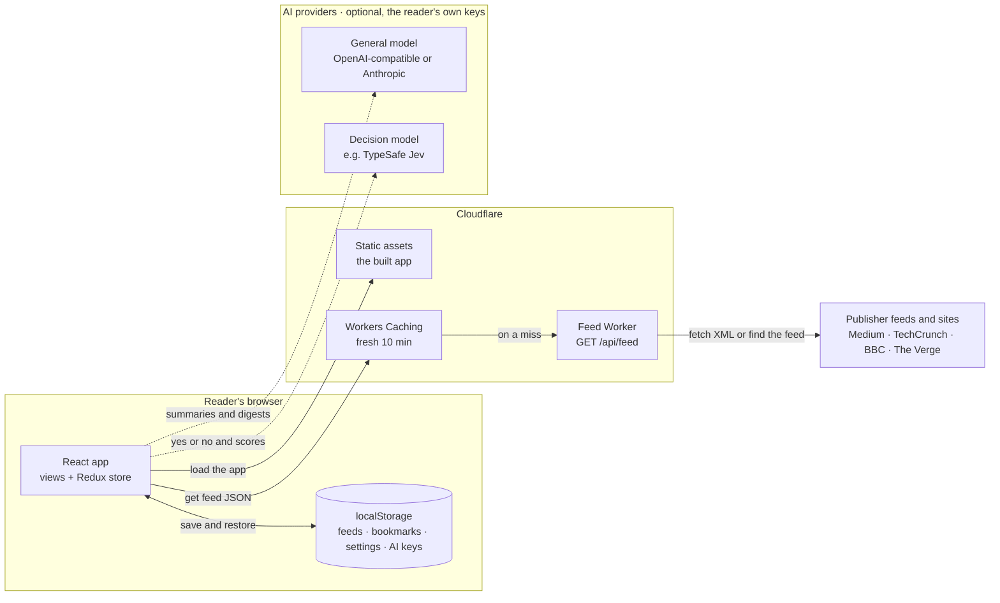

# Feedolio: build plan for a simple RSS reader

> **Feedolio** is a fast, responsive web app for reading RSS and Atom feeds, with bookmarks that persist and optional AI help that runs on the reader's own keys.
>
> - **Status:** ready to build, with every decision settled · updated 2026-11-09, adding search (M14)
> - **Effort:** about 52 hours for the app, about 23 for the optional AI features, and about 6 for search
> - **Combines:** the [detailed spec](to-spec-plan.md) (119 user stories), the [engineering design](anthropic-engineering-plan.md) (architecture decisions, test plan), and research into Feedly, Inoreader, NetNewsWire, Reeder, Feedbin and Readwise Reader
> - **UI draft:** [Feedolio design canvas](https://claude.ai/artifact/FKB1FX259EvfETNCAx4Bgz)

## Summary

- **What we're building:** a reader that shows headlines from several feeds, opens each story on its own page, and saves stories so they're still there next week. It works on phone, tablet and desktop.
- **How it works:** a React app plus one Cloudflare Worker. The Worker fetches feeds on the app's behalf, because publishers block direct browser requests, and turns the XML into clean JSON. It can also find a site's feed from an ordinary website link.
- **Where data lives:** feeds come fresh from the Worker. Bookmarks, feed lists and settings live in the browser, and each bookmark keeps a full copy of its story so it never disappears.
- **Comforts from popular readers:** a Today view, date headers, a "New since your last visit" divider, List or Cards layouts, keyboard shortcuts, reading settings and a collapsible sidebar.
- **Optional AI (stretch):** summarize, translate and explain; plain-English filter rules; and a "Catch me up" digest. Readers bring their own keys, and requests go straight from the browser to the provider they chose. There's no AI backend and no AI cost to us.
- **Search (M14):** one search for the stories in your feeds and everything you've saved, with filters for feed, titles only and date. `/` opens it from anywhere.
- **How we test it:** we drive the real app the way a reader would, against saved copies of real feeds and recorded AI responses. Only the network and the clock are faked.
- **Order of work:** ten milestones for the app (M0–M9), then four for AI (M10–M13), then search (M14). Everything the brief requires is done by M5 plus M8.

> [!NOTE]
> **Ready to build.** Every open question is settled. See [Settled decisions](#11-settled-decisions).

## 1. What we're building

**The problem:** following several publications means visiting each site, wading through clutter, and losing stories you meant to come back to. Raw RSS feeds fix the "structured data" part, but nobody wants to read XML.

**What a reader can do:**

| Feature | Priority | Notes |
|---|---|---|
| Browse story headlines in a list | Must | Source, author, time, short excerpt |
| Open a story on its own page, with everything the feed provides | Must | Summary-only feeds (TechCrunch) link out clearly |
| Bookmark a story, with a clear saved state | Must | Filled icon plus a "Saved" label |
| Keep bookmarks across sessions | Must | Each bookmark stores a full story copy |
| Follow multiple feeds, plus a merged "All stories" view | Must | |
| Add your own feeds by link; manage and remove them | Must | Paste a website or feed link. Feedolio finds the feed and previews it. Everyone starts with five starter feeds. |
| Use it on phone, tablet and desktop | Must | Bottom tabs, drawer, sidebar |
| No CSS libraries | Must | Plain CSS Modules plus design tokens |
| Automated tests | Must | A bonus in the brief, treated as required |
| See each story's main image in the list | Should | A fallback tile when there's no image |
| Today view and date headers | Should | Today, Yesterday, Earlier this week, Older |
| "New since your last visit" divider | Should | A line between new and older stories, instead of read/unread tracking |
| List or Cards layout, with density | Should | Remembered on the device |
| Keyboard shortcuts | Should | J/K, Enter, V, S, R, and `?` for the full list |
| Collapsible sidebar on desktop | Should | Shrinks to a slim icon rail; `[` toggles it; remembered |
| Search and filter stories | Should | Your feeds' stories now and everything saved; filter by feed, titles only and date; `/` opens it |
| Reading settings on the story page | Should | Text size, serif or sans, line width |
| First-visit welcome note | Should | Explains the starter feeds; one tap to add your own |
| Share to X, Facebook, LinkedIn or email | Should | Share links only, no tracking scripts |
| Redux for state | Should | Redux Toolkit |
| Light and dark theme | Should | Follows the system by default |
| Sign in with GitHub (OAuth) | Should | Optional for readers; data stays per device |
| AI article actions: Summarize, Translate, Explain | Stretch | The reader's own key |
| AI filter rules: hide, highlight or tag new stories | Stretch | Uncertain matches go to "Maybe"; nothing is ever deleted |
| AI "Catch me up" digest | Stretch | Groups unread stories and links to the sources |

Every feature traces to user stories **US-01 to US-119** in the [detailed spec](to-spec-plan.md).

## 2. How it works



**A feed request, step by step:**

1. The app asks `GET /api/feed?url=<feed or website URL>` for each feed the reader follows.
2. Cloudflare answers from its cache when it can. A feed is fresh for 10 minutes, and stale copies cover publisher outages.
3. On a cache miss, the Worker fetches the XML, parses it, and maps it into one simple **Story** shape (§5). If the link is a web page, it finds the page's feed first.
4. The app merges the feeds, sorts them newest first, and shows them. A failed feed shows its own Retry row, and the other feeds still appear.

**Opening a story** (`/feeds/:feedId/stories/:storyId`) looks in four places, in order:

1. Feeds already loaded.
2. A fresh fetch of that feed.
3. The bookmark copy.
4. Otherwise a friendly "no longer available" page with a link to the original.

**AI requests** (optional) go straight from the browser to the providers the reader chose, using their keys. They never pass through the Worker (§7).

**Search** runs in the browser, over the stories already loaded for the reader's feeds and the copies kept with saved stories. There's no index on a server (M14).

## 3. Key decisions

| Topic | Decision | Why |
|---|---|---|
| Getting feed data | **Our own Worker proxy** | Publishers block cross-site browser requests. Owning the proxy also gives us one clean data shape, caching and testability. |
| Adding feeds | **Feed discovery in the Worker** | Readers paste whatever link they have. The Worker follows the page's `<link rel="alternate">` to its feed. |
| Hosting | **Cloudflare Workers** (static assets plus one Worker) | Cloudflare now recommends Workers over Pages for new projects. One deployable, and the free plan fits. |
| Parsing XML | **`fast-xml-parser`** and our own normaliser | Pure JavaScript, so it runs on Workers. About 1 ms on the largest feed, against a 10 ms CPU limit on the free plan. |
| App state | **Redux Toolkit** and **RTK Query** | Covers the Redux bonus. Caching, retries and loading states come built in. |
| Saving data | **`localStorage`**, versioned, storing full story copies | Saved stories survive when they leave the feed or their feed is removed. Simple and synchronous. |
| What's new | **A "since your last visit" divider**, not read/unread tracking | Returning readers see what's new at a glance, with no counts to maintain. This is Reeder's approach. |
| Styling | **CSS Modules** plus design tokens | CSS libraries aren't allowed. Tokens make dark mode a value swap. |
| Story HTML | **DOMPurify** when rendering | Feed content is untrusted, so scripts and unsafe links are removed. |
| Sharing | **Plain share links** and the Web Share API | No social SDKs or trackers. A Facebook "Like" button would need both. |
| Sign-in | **Auth0 with GitHub** | No backend needed. Signing in only separates data per user on the device. |
| AI (stretch) | **Bring your own key, straight from the browser** | No AI backend and no AI cost to us. The reader chooses the provider. |
| AI providers | **Anthropic SDK** or any **OpenAI-compatible** endpoint, plus an optional **decision model** | Covers Claude, OpenAI, OpenRouter and local Ollama. Yes/no and scoring go to the decision model when there is one. |
| Search | **In the browser, over loaded and saved stories** | Nothing to run or index on a server. It finds what the feeds hold now and everything saved, not years of history. |

> [!WARNING]
> **Cloudflare caching gotcha:** on Cloudflare, `s-maxage` quietly turns off `stale-while-revalidate` and `stale-if-error`. The Worker sets the edge cache with `Cloudflare-CDN-Cache-Control` instead (§6).

The trade-offs behind each choice are written up as decision records in the [engineering design](anthropic-engineering-plan.md#5-trade-off-analysis-architecture-decision-records).

## 4. Screens

The [design canvas](https://claude.ai/artifact/FKB1FX259EvfETNCAx4Bgz) has every screen below, plus colour and type tokens and component sheets.

| Screen | Route | What's on it |
|---|---|---|
| All stories | `/` | Every enabled feed merged, newest first, under date headers; the "New since your last visit" divider; a lead story card on desktop |
| Today | `/today` | Stories from the last 24 hours |
| One feed | `/feeds/:feedId` | That feed's stories |
| Story | `/feeds/:feedId/stories/:storyId` | Title, byline, image, full body or summary with a "Continue reading" link, Save, Share, previous/next, reading settings (Aa) |
| Saved | `/bookmarks` | Bookmarks, most recently saved first; Undo after removing one |
| Search | `/search?q=` | A search field; Search in (All feeds, Saved or one feed), Titles only, and Any time, Today or This week; results newest first with matches highlighted; a no-matches state that says what search covers |
| Add a feed | Dialog, from "+ Add feed" | Paste any link; preview with the latest headlines and posts a week; a choice when a page has several feeds |
| Settings | `/settings` | Feeds (hide, remove, suggested feeds), Appearance (theme, layout, density, reading defaults), Account |
| Keyboard shortcuts | Overlay, press `?` | Every shortcut |
| *AI:* Catch me up | `/catch-up` | Grouped stories ranked by importance, with summaries and source links |
| *AI:* Maybe and Hidden | `/maybe`, `/hidden` | Uncertain rule matches to confirm; stories hidden by rules, with Unhide |
| *AI:* Tags | `/tags/:tag` | Stories a rule tagged |
| *AI:* Settings | `/settings/ai`, `/settings/rules` | Keys and models; plain-English filter rules |

| Screen width | Layout |
|---|---|
| Under 640 px | Top bar, scrolling feed chips (Today first), bottom tabs (Stories · Saved · Settings) |
| 640–1023 px | Feed list in a slide-out drawer |
| 1024 px and up | Sidebar with feeds that collapses to a 64 px icon rail (button or `[`), expanded by default from 1280 px and collapsed at 1024–1279 px; reading column 680 px wide |

Search sits at the top of the sidebar, as a magnifier on the rail, and as a button in the top bar on smaller screens.

## 5. Data

```js
/** One story, the same shape for every feed format. */
Story = {
  id, feedId,          // stable hashes
  title, link,         // link = publisher's page (what Share uses)
  author, publishedAt, // publishedAt may be null; those sort last
  categories,          // string[]
  excerpt,             // plain text, ~200 chars
  contentHtml,         // raw HTML; sanitised only when rendered
  hasFullContent,      // false for summary-only feeds
  imageUrl,            // main image, or null (UI shows a monogram tile)
}

Subscription = { id, url, title, enabled, isDefault, addedAt }
Bookmark     = { id, feedId, feedTitle, savedAt, story /* full Story copy */ }
Preferences  = { theme, layout /* list | cards */, density, reading: { size, font, width },
                 sidebar /* auto | expanded | collapsed; auto = rail at 1024–1279 px */ }
Visits       = { lastVisitAt, lastCatchUpAt, openedIds /* most recent 2,000 */ }

// localStorage["feedolio:v1"] = { version: 1, subscriptions, bookmarks, preferences, visits }

// AI (stretch)
AiSettings = { general: { provider, baseUrl, model }, decision: { provider, model } | null,
               features, translateTo, rememberKeys }
Rule       = { id, text, action /* hide | highlight | tag */, tag, enabled, version }
Judgment   = { storyId, ruleId, ruleVersion, verdict /* match | maybe | no */, confidence,
               by /* decision | general */, readerSaid /* yes | no | undefined */ }

// localStorage["feedolio:v1"] also holds aiSettings and rules (never keys)
// localStorage["feedolio:ai-keys:v1"] holds keys only (sessionStorage when "Remember" is off)
// IndexedDB "feedolio-ai" holds judgments and cached AI output
```

**The "New since your last visit" divider:**
- At start-up, the app reads `lastVisitAt` from the previous session and uses it as this session's cut-off.
- Stories published after the cut-off sit above the divider.
- `lastVisitAt` moves forward when the reader leaves the page.
- A first visit has no cut-off, so it shows the welcome note instead.

**Picking the main image.** The first rule that matches wins:

1. `media:content` or `media:thumbnail` (largest wins).
2. An image `enclosure`.
3. The first real `` in the body, skipping tracking pixels, `data:` URIs and icons.
4. None: the UI shows a tile with the publication's initial.

**Starter feeds.** Every new reader starts with these five. Readers can hide or remove any of them, add their own by link, and restore the starters from Settings.

| Feed | Format | What it tests |
|---|---|---|
| Backchannel, The Economist (Medium) | RSS, full HTML | Images in the body; a tracking pixel to skip. Both are archived (last posts 2018 and 2020). |
| TechCrunch Startups (`/category/startups/feed/`) | RSS, summary only | No images and no full body. TechCrunch moved its feeds under `/category/`, and the brief's old address now returns 404. |
| BBC Technology | RSS + Media RSS | `media:thumbnail` images |
| The Verge | Atom | Atom parsing |

## 6. Feed endpoint

`GET /api/feed?url=<feed or website URL>` returns `{ feed, stories, fetchedAt }`. `feed.postsPerWeek` is worked out from the story dates and shown in the add-feed preview.

**Finding the feed from a website link:**
- If the link returns a web page, the Worker reads up to 1 MB of it and looks for `<link rel="alternate">` tags of type RSS or Atom.
- **One feed:** the Worker fetches it, under the same safety rules.
- **Several feeds:** it returns `{ choices: [{ title, url }] }` so the reader can pick one.
- **None:** it returns `NO_FEED_FOUND`.

| Error code | HTTP | When |
|---|---|---|
| `INVALID_URL` | 400 | Not an absolute http(s) URL |
| `BLOCKED_HOST` | 400 | `localhost`, a private or reserved IP, or a port other than 80/443 |
| `UPSTREAM_TIMEOUT` | 504 | No answer within 8 s |
| `UPSTREAM_ERROR` | 502 | Publisher returned an error status or the connection failed |
| `NOT_A_FEED` | 422 | Neither a feed nor a web page, e.g. an image or JSON |
| `NO_FEED_FOUND` | 422 | A web page with no feed link |
| `TOO_LARGE` | 502 | Body over 5 MB |

Response headers on success:

```http
Cloudflare-CDN-Cache-Control: max-age=600, stale-while-revalidate=3600, stale-if-error=86400
Cache-Control: no-cache
```

**Safety rules:**
- Only http(s), on ports 80 and 443.
- At most 3 redirects, each one re-checked; the same checks apply to a discovered feed link.
- An 8 s timeout and a 5 MB cap.
- Errors are never cached.

## 7. AI features (stretch)

> [!NOTE]
> **Optional and last.** Build this after M0–M9. Feedolio works fully without AI; AI controls appear only after a reader adds a key.

### 7.1 Bring your own key

Readers add their keys in Settings › AI. Feedolio never sees them: every AI request goes from the browser straight to the provider.

| Role | Options | Used for |
|---|---|---|
| **General model** (required for AI) | **Anthropic**, or any **OpenAI-compatible** endpoint: OpenAI, OpenRouter, Ollama on the reader's computer, or a custom URL | Summaries, translations, explanations; grouping and summarising the digest |
| **Decision model** (optional) | **TypeSafe Jev**, through TypeSafe's API, or OpenRouter once it's served there | Yes/no rule matching and importance scores, with calibrated confidence |

- **Without a decision model,** the general model does the judging too. It returns `{ match, confidence }` through structured output, but its confidence is self-reported, so Feedolio uses a wider "Maybe" band (§7.2).
- **Browser access, checked 2026-11-09:**
  - Anthropic, OpenAI and OpenRouter accept requests straight from a web page.
  - Ollama needs `OLLAMA_ORIGINS` set to Feedolio's address, and some browsers ask permission before a website can reach a local server.
  - Other OpenAI-compatible servers work only if they allow browser requests. "Test connection" says so in plain words.
- **Anthropic:** use the official SDK in browser mode (`dangerouslyAllowBrowser: true`, safe here because the key is the reader's own).
  - The default model is `claude-opus-5-5`; readers can pick any model from the list their key returns.
  - Effort is set per task: low for quick actions, medium for the digest.
  - JSON answers use structured output.
  - Refusals are handled with Anthropic's server-side fallback.
- **OpenAI-compatible:** a small `fetch` adapter for `/chat/completions`, with streaming. It uses `response_format: json_schema` where supported, and validated JSON otherwise.
- **Jev:** TypeSafe's public API reference couldn't be found on 2026-11-09. OpenRouter lists `~typesafe/jev-latest` with a "decisions" output, but no serving endpoints yet. Confirm the request format before M12. Until then, the general model covers judging.

### 7.2 The three features

| Feature | What the reader does | How it works |
|---|---|---|
| **Article actions** | Taps Summarize, Translate (picks a language) or Explain on a story page | Streams the answer into a panel labelled with the model. Cached per story, action and language. On summary-only stories, actions work on the summary and say so. |
| **Filter rules** | Writes rules like "Hide event announcements" and picks Hide, Highlight or Tag | Each new story is checked once per rule version, in batches. Decision model: **≥ 75%** applies the action, **40–75%** goes to Maybe, **< 40%** is ignored. General model: 85% and 30–85%. The reader's yes/no in Maybe is remembered. Hidden stories stay in Hidden; nothing is ever deleted. |
| **Catch me up** | Taps one button | Takes unread stories since the last catch-up, up to 60; "unread" means not opened and not hidden. The general model groups them into stories, citing story IDs. The decision model, or the general model, ranks the groups by importance. Each group gets a short summary, and its links come from Feedolio's own story data, never from model text. "Mark all caught up" resets the window. |

### 7.3 Which model does what

| Task | Kind | Goes to |
|---|---|---|
| Summarize, Translate, Explain | Generate, streamed | General model |
| Match a story against rules | Yes/no + confidence | Decision model, else general |
| Group the digest into stories | Generate, JSON | General model |
| Rank digest stories | Score | Decision model, else general |
| Summarise each digest story | Generate | General model |

### 7.4 Keeping keys safe

> [!IMPORTANT]
> Keys sit in the same browser as untrusted feed content, so any injected script could steal them. Nothing from a feed or a model may ever run as code.

- **Feed content:** all feed HTML goes through DOMPurify. Titles and excerpts are always plain text.
- **Model output:** shown as text through a tiny paragraph-and-list formatter we own, never as HTML. Links in AI panels come only from Feedolio's story data.
- **Prompt injection:** feed text is fenced and labelled as untrusted in every prompt. Models get no tools, so a hostile feed can at worst mislabel a story, and a mislabelled story lands in Maybe or Hidden, where the reader can still see it.
- **Content Security Policy:** scripts only from Feedolio itself (no third-party scripts at all), with Trusted Types on. The small inline script that applies the theme before first paint is allowed by its hash. `connect-src` has to allow any https host and localhost, because readers choose their own endpoints. So the policy can't stop data leaving, and stopping script injection is the real defence.
- **Key storage:**
  - Keys are stored apart from other data, never logged or put in error messages, and never sent to `/api/feed`.
  - With "Remember on this device" off, keys live only as long as the tab.
  - One button removes them all.
  - Signed-in readers get keys per account.
- **Privacy:** only the stories a reader acts on, or that rules check, go to their provider. Settings says so plainly and shows this session's usage.

### 7.5 Cost and speed (the reader pays)

- Check rules in batches of up to 25 stories, once per story and rule version, and never again on refresh.
- Cache AI results in IndexedDB.
- Cap the digest at 60 stories.
- Show a usage counter in Settings.

## 8. Build plan

| # | Milestone | Stories | Est. |
|---|---|---|---|
| M0 | Foundations | — | 2 h |
| M1 | Feed Worker, with feed discovery | US-78, US-90, US-91 | 8 h |
| M2 | App shell, headline list, Today and date headers | US-01–05, US-10, US-16–20, US-66–68, US-82, US-83 | 6.5 h |
| M3 | Story page and reading settings | US-21–35, US-89 | 5.5 h |
| M4 | Bookmarks | US-36–48 | 4 h |
| M5 | Multiple feeds, Settings, add any link, divider | US-06–09, US-11–15, US-55–65, US-84, US-92–94 | 9 h |
| M6 | Polish: dark mode, accessibility, shortcuts, layouts, sidebar | US-69–72, US-85–88, US-115 | 9 h |
| M7 | Sharing | US-49–54 | 2 h |
| M8 | Ship: README, deploy, final QA | US-79–81 | 3 h |
| M9 | GitHub sign-in | US-73–76 | 3 h |
| M10 | AI foundations: keys, providers, safety | US-95–99, US-113, US-114 | 6 h |
| M11 | AI article actions | US-100–103 | 4 h |
| M12 | AI filter rules, Maybe and Hidden | US-104–108 | 7 h |
| M13 | AI Catch me up | US-109–112 | 6 h |
| M14 | Search and filter | US-116–119 | 6 h |

> [!TIP]
> **Short on time?** M0–M5 plus M8 (about 38 hours) deliver everything the brief requires. Then add M6, M7 and M9. The AI milestones come last, starting with M10.

**Done means, for every milestone:**
- Tests pass in CI.
- No accessibility violations on the views it touched.
- Works at 390 px and 1280 px wide.
- Deployed to a preview URL.
- README updated if behaviour changed.

### M0 · Foundations

- [ ] Vite + React (JavaScript) app, ESLint, Prettier
- [ ] Vitest, Testing Library, MSW; one example journey test
- [ ] Router with empty views; Redux store with empty slices
- [ ] `tokens.css` and `base.css` from the design canvas
- [ ] Wrangler config: static assets in single-page-app mode, Workers Caching on, Cloudflare Vite plugin
- [ ] CI on GitHub Actions; Workers Builds for preview URLs

**Done when** `npm run dev` serves the app shell and a placeholder `/api/feed`, and a preview URL is live.

### M1 · Feed Worker

- [ ] URL guard: scheme, port, `localhost`, literal private IPs; redirects re-checked
- [ ] Fetch with an 8 s timeout and 5 MB cap
- [ ] Parse with `fast-xml-parser`; normalise RSS and Atom into `Story`
- [ ] Main-image rules and the `hasFullContent` flag
- [ ] Feed discovery from a web page: one feed, several (`choices`), or `NO_FEED_FOUND`
- [ ] `postsPerWeek` from story dates
- [ ] Save the five feeds, two web pages and the edge cases as test fixtures
- [ ] Contract tests for every error code and the cache headers

**Done when** all five fixtures produce the expected stories and images, pasting `theverge.com` finds its Atom feed, and each error code has a passing test.

### M2 · App shell, headline list, Today and date headers

- [ ] Responsive shell: sidebar, drawer, bottom tabs
- [ ] `getFeed` query; story rows with source, time, author and excerpt
- [ ] Main image with lazy loading, plus the monogram tile fallback
- [ ] Loading skeleton and per-feed error row with Retry
- [ ] Date headers: Today, Yesterday, Earlier this week, Older
- [ ] Today view (`/today`): the last 24 hours across enabled feeds

**Done when** one feed's headlines show correctly on phone and desktop, including the no-image case, and Today shows only the last 24 hours.

### M3 · Story page and reading settings

- [ ] Route and the four-step story lookup
- [ ] Sanitised body: links open in a new tab; iframes become "View on the original site" links
- [ ] Summary-only layout with a "Continue reading on {site}" button
- [ ] Reading time, previous/next links, no duplicate hero image
- [ ] Reading settings (Aa): text size, serif or sans, line width; remembered

**Done when** a hostile test feed can't inject script, a reload keeps the story on screen, and reading settings survive a reload.

### M4 · Bookmarks

- [ ] Bookmarks slice storing full story copies; toggle, remove, restore
- [ ] Versioned `localStorage` layer: validate on load, throttled saves, warning when full
- [ ] Cross-tab sync via the `storage` event
- [ ] Saved page, empty state and Undo toast

**Done when** a bookmark survives a reload, its story leaving the feed, and its feed being removed.

### M5 · Multiple feeds, Settings, add any link, divider

- [ ] Subscriptions slice with the five starter feeds
- [ ] All stories: merge, remove duplicates, sort, with per-feed errors
- [ ] Add-a-feed dialog: paste any link, see the preview (latest headlines, posts a week), pick when there are several feeds
- [ ] Settings: hide, remove, restore starters, suggested feeds, duplicate check; theme switch
- [ ] "New since your last visit" divider, driven by `lastVisitAt`
- [ ] First-visit welcome note

**Done when** a reader can paste a website link, add its feed, and see it in All stories, and on their next visit a divider marks what's new.

### M6 · Polish: dark mode, accessibility, shortcuts, layouts, sidebar

- [ ] Dark theme tokens; theme applied before first paint
- [ ] Keyboard pass: visible focus, skip link, focus restored on Back
- [ ] Shortcuts with a `?` overlay: J/K, Enter or O, V, S, R, `[`, G then T/A/S, Esc. Shortcuts are off while typing.
- [ ] List or Cards layout; Comfortable or Compact density; remembered
- [ ] Collapsible sidebar: a 64 px icon rail with tooltips and count badges. The toggle reports `aria-expanded`, and every rail icon keeps an accessible name. Expanded by default from 1280 px; the reader's choice is remembered.
- [ ] Screen-reader pass: landmarks, one `h1` per view, `aria-pressed` on Save
- [ ] Reduced motion; automated audit (axe) on every view

**Done when** every view has no serious accessibility issues in both themes, and a reader can browse, open and save stories with the keyboard alone.

### M7 · Sharing

- [ ] Share links for X, Facebook, LinkedIn and email
- [ ] Native share sheet on phones; Copy link with a "Copied" message

**Done when** each button opens the right share page for the story's original link.

### M8 · Ship

- [ ] README: setup, commands, decisions, trade-offs, what's next
- [ ] Security headers for the app's pages; Playwright smoke test on the preview
- [ ] Final check on a real phone; production deploy

**Done when** a reviewer can open the live URL and follow the README from a clean checkout.

### M9 · GitHub sign-in

- [ ] Auth0 app with GitHub login; `.env.example`
- [ ] Separate saved data per signed-in user; offer to import guest bookmarks

**Done when** two accounts on one browser see separate bookmarks, and signed-out use still works.

### M10 · AI foundations: keys, providers, safety

- [ ] Settings › AI: provider, base URL, model list, key, "Remember on this device", Test connection, Remove all keys
- [ ] Adapters: Anthropic SDK (browser mode); OpenAI-compatible `fetch` with streaming; decision model with a general-model fallback
- [ ] Task router (§7.3); key store kept apart from `feedolio:v1`; IndexedDB cache
- [ ] CSP with Trusted Types; output-as-text formatter; usage counter

**Done when** a reader can connect each provider type, see "Connected", and remove every key, and no test can get a key sent anywhere except its provider.

### M11 · AI article actions

- [ ] Summarize, Translate (language menu) and Explain on the story page
- [ ] Streaming panel with provenance, Copy, Regenerate and the "AI can make mistakes" note
- [ ] Cache per story, action and language; summary-only notice

**Done when** Summarize streams from a recorded provider response, and model output containing HTML shows as plain text.

### M12 · AI filter rules, Maybe and Hidden

- [ ] Rules editor: plain-English text, Hide/Highlight/Tag, "Test on recent stories"
- [ ] Batched checks of new stories; thresholds; judgments saved per rule version
- [ ] Highlight and tag styling; Maybe view with Yes/No that's remembered; Hidden view with Unhide; tag pages

**Done when** a rule hides the Founder Summit fixture story, sends an uncertain story to Maybe, and nothing ever disappears from Hidden.

### M13 · AI Catch me up

- [ ] Opened-story record and `lastCatchUpAt`
- [ ] Grouping with story-ID citations; ranking; one summary per group
- [ ] Digest page with importance, summaries and source links; "Mark all caught up"

**Done when** the fixture stories group into ranked stories, every source link opens a real story in Feedolio, and "Mark all caught up" starts a new window.

### M14 · Search and filter

How others do it (checked 2026-11-09): Feedly's Power Search sits in the left navigation, with a scope menu (all feeds, chosen feeds, Boards, the web), Title-only and date filters, and operators. Inoreader adds a search box above every feed's list, and keeps saved searches ("monitoring feeds") and public-feed search for Pro. Feedbin and Miniflux focus search with `/`. This milestone builds the basics they share. Operators, saved searches and searching beyond your feeds stay out (§12).

- [ ] Search page (`/search?q=…`), loaded on demand: a search field, results newest first in the usual story rows, matching words highlighted, and a count. The query lives in the URL, so Back returns to the results.
- [ ] Filters: Search in (All feeds, Saved or one feed), Titles only, and Published (Any time, Today, This week)
- [ ] Matching: every word must appear, "quoted phrases" match exactly, and case and accents are ignored. Fields are the title, summary, author and feed name. Stories hidden by rules stay hidden.
- [ ] Entry points: Search at the top of the sidebar, a magnifier on the rail, and a search button in the top bar on phones and tablets. `/` opens search from anywhere, within the current feed on a feed's page. Esc clears the field.
- [ ] No matches: say what search covers (the stories in your feeds now, and everything saved), and offer to search all feeds or clear the filters
- [ ] A Rules link in the sidebar's AI group, so filter rules are easy to find
- [ ] First-page budget: the page loads on demand and the entry points cost a few hundred bytes. Everything the first page loads stays in one chunk (a `$initial` code-splitting group), because the bundler otherwise splits shared code into many small chunks once a lazy page shares it, which costs about 2 KB.

**Done when** searching "AI" finds matching stories across feeds and Saved with the words highlighted, Titles only and the date filters narrow the results, `/` on a feed's page searches within that feed, and a search with no matches explains what search covers.

## 9. Testing

**Approach (settled):** journey tests are the main tool. Unit tests cover only dense logic, and contract tests cover the Worker.

**Principles:**
- **Test behaviour, not code.** Assert on what a reader sees and does, or on what `/api/feed` returns. Never assert on Redux state or CSS classes, and don't use snapshot tests.
- **Fake only what we don't own.** The network gets saved feed files and recorded AI responses, and the clock is frozen. Everything else runs for real.
- **Use real fixtures.** Saved copies of the five feeds, plus edge cases: hostile HTML, missing dates, an empty feed, an HTML 404 page, and web pages with one, several or no feed links.

| Layer | What it covers | Tools | About |
|---|---|---|---|
| **Journey tests** (main) | The real app in a simulated browser. Calls to `/api/feed` run the real Worker code, publisher requests get fixture files, and AI providers get recorded responses. | Vitest, Testing Library, MSW | 35 |
| **Endpoint contract** | Error codes, cache headers, discovery and parsed output, run inside the Workers runtime | Vitest + Cloudflare Vitest plugin | 18 |
| **Unit tests** (only for dense logic) | Normaliser, main-image rules, URL guard, storage migration, AI threshold logic | Vitest | 35 |
| **Smoke** (optional) | Real browsers and real feeds against the preview URL | Playwright | 3 |

**Must-pass scenarios:**

| Scenario | Expected |
|---|---|
| One feed fails while others load | That feed shows Retry; the rest of All stories appears |
| Open a TechCrunch story | Summary plus a link to techcrunch.com |
| Story from the hostile fixture | No script, no event handlers, no `javascript:` links in the page |
| Save, reload, then the story leaves the feed | The story still opens from Saved |
| Bookmark in one tab | It appears in another open tab |
| Paste `theverge.com`; paste a page with no feed | Finds the Atom feed; a clear "couldn't find a feed" error |
| Feed URL that resolves to `localhost` or a private IP | `BLOCKED_HOST` |
| Old TechCrunch URL (HTML 404) | `UPSTREAM_ERROR` with status 404 |
| Second visit after new stories arrive | Divider between new and older stories; a first visit shows the welcome note instead |
| Collapse the sidebar with `[`, then reload | Still collapsed; every rail icon has an accessible name |
| AI output containing `` | Shown as text; nothing runs |
| Digest cites an unknown story ID | Dropped; no model-made links appear |
| Decision model set, then removed | Judging goes to the decision model, then to the general model with the wider Maybe band |
| Any request to `/api/feed` | Never carries an AI key |
| Search "AI chips", then Titles only, then a quoted phrase | Only stories with every word; then only those with them in the title; then the exact phrase. Matches are highlighted. |
| Press `/` on The Verge's page, then Esc | Search opens within The Verge; Esc clears the field |

## 10. Risks

| Risk | Plan |
|---|---|
| A publisher moves its feed (TechCrunch already has) | Tests use fixtures; the Worker follows redirects; readers can update feeds in Settings |
| Medium feeds look stale (2018–2020) | Two live starter feeds; dates shown honestly |
| Worker misused as an open proxy | URL and IP checks, size cap, caching; rate limiting later |
| Workers free plan limits (10 ms CPU, 100k requests a day) | Parsing takes about 1 ms and caching keeps calls rare. The $5/month plan lifts both. |
| Browser storage fills up with story copies | A warning toast; move to IndexedDB if it ever matters (about 300 long stories fit) |
| Key theft through injected script | Sanitising, text-only AI output, strict CSP with Trusted Types, no third-party scripts |
| Prompt injection in feed text | No tools, fenced input, limited actions; mislabelled stories stay visible in Maybe or Hidden |
| A provider blocks browser requests | Test connection explains it; OpenRouter is an alternative |
| Jev's request format is unconfirmed | General-model fallback; confirm before M12 |
| Readers surprised by AI costs | AI off until set up; batching, caching and a usage counter |

## 11. Settled decisions

| Question | Decision |
|---|---|
| Can the app use a small server-side Worker to fetch feeds? | **Yes.** |
| Which default feeds? | **The brief's three** (TechCrunch at its current address) **plus BBC Technology and The Verge.** |
| Does sign-in need to sync bookmarks across devices? | **No.** Sign-in only separates data per user on the device. |
| How do we test? | **Journey tests first** (§9). Unit tests only for dense logic. |
| Priorities | **Adding your own feeds is a Must.** Theme and GitHub sign-in are Should. |
| What's new since last time? | **A light "New since your last visit" divider**, like Reeder. No unread counts. |
| Ideas from other readers | **All seven:** shortcuts, add any link, date headers, Today, List or Cards, reading settings, welcome note. |
| Sidebar | **Collapsible on desktop** to a slim icon rail; `[` toggles it; the choice is remembered. |
| AI | **Stretch:** article actions, filter rules and Catch me up, on the reader's own keys, with an optional decision model. |
| Search | **Basic search and filter (M14)** in the browser, over your feeds' stories and everything saved, after looking at Feedly, Inoreader, Feedbin and Miniflux. No operators, saved searches or server index. |

Settled 2026-11-08 and 2026-11-09.

**What happened to the TechCrunch feed:** TechCrunch moved its section pages and feeds under `/category/`.
- **Until mid-2022:** the brief's address (`techcrunch.com/startups/feed/`) served the feed.
- **From October 2022:** it redirected to the new address.
- **By October 2026:** the redirect was gone and it returns a "Page not found" page.

The feed itself is alive at `techcrunch.com/category/startups/feed/`. Source: live checks and Wayback Machine snapshots.

## 12. Not in this version

- Syncing across devices (not required), or any database of our own
- Full read/unread tracking with counts (the divider covers "what's new"), folders, OPML import, notifications, offline mode
- Search operators (OR, NOT), saved searches, and searching beyond your feeds or further back than they go, which would need an index on a server
- Pulling full articles from publisher sites, or finding images for feeds that have none
- Facebook "Like" button or any social SDK
- Embedded videos and iframes; these link to the original instead
- AI that would need our own server: shared caching, scheduled or emailed digests
- TypeScript, server-side rendering, the interface in other languages

## Appendix: notes for implementers

**Ground rules:**
- JavaScript only, with JSDoc for shapes. No TypeScript.
- No CSS libraries. Use CSS Modules, and take values from `tokens.css` (copied from the design canvas).
- Domain words: **Feed**, **Subscription**, **Story**, **Bookmark**, **Rule**. The UI says "Save" and "Saved".
- Never render model output as HTML, and never send a key anywhere except its provider.
- Each milestone is a separate pull request, with tests in the same pull request.

**Commands:**

| Command | Does |
|---|---|
| `npm run dev` | App and Worker together (Cloudflare Vite plugin) |
| `npm test` | All Vitest suites |
| `npm run build` | Production build |
| `npx wrangler deploy` | Deploy to Cloudflare |

**Project layout:**

```text
src/
  app/          store, router, persistence, visits
  features/     feeds · story · bookmarks · subscriptions · preferences · share · auth · shortcuts
  features/ai/  providers (anthropic, openaiCompatible, decision) · router · keys · cache · actions · rules · digest
  components/   AppShell, StoryRow, StoryCard, StoryImage, MonogramTile, DateHeader, Toast, Icon (*.module.css)
  styles/       tokens.css, base.css
worker/
  index.js      routes /api/feed
  lib/          handleFeedRequest, safeFetch, discoverFeed, normaliseFeed, pickMainImage
public/_headers security headers for the app's pages
test/           fixtures/feeds, fixtures/pages, fixtures/ai, msw handlers, journey tests
wrangler.jsonc  static assets (single-page-app mode), Workers Caching on
```

**Further reading:** the [detailed spec](to-spec-plan.md) has every user story. The [engineering design](anthropic-engineering-plan.md) has the decision records, data flows, error handling and full test list.
